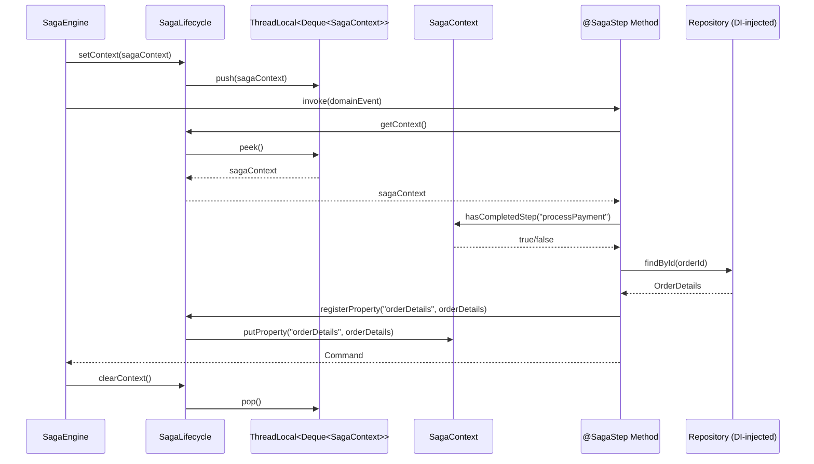
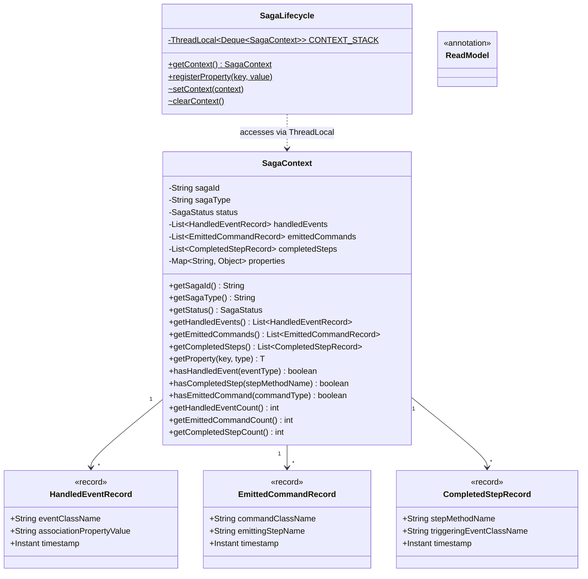

# Design Document: Saga Context & Lifecycle

## Overview

This design introduces two core components to the Saga Forge framework: **SagaContext** (a read-only view of saga progress state and registered properties) and **SagaLifecycle** (a static utility providing thread-safe access to the current saga's context from within step methods). Together, they enable developers to query saga history at runtime and enrich the saga with data fetched from external read models — all without polluting step method signatures.

**What is in scope:**
- `SagaContext` class — read-only, holds progress state (handled events, emitted commands, completed steps) and registered properties
- `SagaLifecycle` static utility class — ThreadLocal-based entry point for `getContext()` and `registerProperty()`
- Progress state record types: `HandledEventRecord`, `EmittedCommandRecord`, `CompletedStepRecord`
- `@ReadModel` marker annotation
- Persistence model extension for progress state and context properties
- Enhanced `OrderProcessingSaga` example demonstrating the full pattern
- Thread safety guarantees via ThreadLocal with proper cleanup

**What is out of scope:**
- Saga engine runtime implementation (the engine that calls these APIs)
- Spring-specific DI auto-configuration for repository injection
- Storage provider implementations
- Event transport implementations
- Compensation flow interaction with progress state

**Key design decisions:**
1. **SagaContext is a class, not a record** — it needs mutable internal state (properties added via SagaLifecycle) while exposing a read-only public API
2. **SagaLifecycle uses ThreadLocal** — follows the Axon Framework `AggregateLifecycle` pattern; each thread gets its own context reference with no synchronization overhead
3. **Progress state records are Java records** — immutable, compact, with non-null validation in compact constructors
4. **No custom DI** — the framework relies entirely on external DI (Spring, Jakarta CDI, etc.) for repository injection; `@ReadModel` is purely a marker
5. **Nested context support** — SagaLifecycle preserves outer context when nested invocations occur on the same thread (stack-based ThreadLocal)
6. **Persistence via existing SagaInstance** — progress state and properties are stored in the existing `state` map of `SagaInstance`, avoiding SPI-breaking changes

## Architecture

### Component Interaction



### Package Layout

```
saga-forge-core/src/main/java/io/github/gkosharovdev/sagaforge/core/
├── annotation/
│   ├── ... (existing annotations)
│   └── ReadModel.java                    ← NEW: marker annotation
├── context/                              ← NEW: entire package
│   ├── SagaContext.java                  ← read-only context class
│   ├── SagaLifecycle.java               ← static utility with ThreadLocal
│   ├── HandledEventRecord.java          ← progress state record
│   ├── EmittedCommandRecord.java        ← progress state record
│   └── CompletedStepRecord.java         ← progress state record
├── scanner/
│   └── ... (existing scanner)
└── spi/
    └── ... (existing SPI)
```

### Design Rationale

1. **ThreadLocal with Deque (stack)**: Using a `Deque<SagaContext>` rather than a plain `ThreadLocal<SagaContext>` supports nested saga invocations on the same thread. The engine pushes before invoking a step and pops in a finally block. This is a defensive design — even if nested sagas are rare, the cost is negligible and it prevents subtle bugs.

2. **SagaContext as a class with package-private mutators**: The public API is entirely read-only (`get*` methods). The `SagaLifecycle` class (same package) calls package-private methods to register properties. This enforces the invariant that developers cannot mutate context directly — they must go through `SagaLifecycle`.

3. **Progress state in existing `state` map**: Rather than adding new fields to `SagaInstance` (which would break the SPI contract for existing StorageProvider implementations), progress state and properties are serialized into the existing `Map<String, Object> state` field under well-known keys. This is backward-compatible.

4. **@ReadModel as pure marker**: The annotation carries no runtime behavior in `saga-forge-core`. It serves as documentation and enables future tooling (e.g., Spring auto-configuration could scan for `@ReadModel` types). The framework does not inject repositories — external DI does.

5. **Non-null validation in record constructors**: All three progress state records enforce non-null fields via `Objects.requireNonNull` in compact constructors. This fails fast at construction time rather than producing NPEs downstream.

## Components and Interfaces

### SagaContext

```java
package io.github.gkosharovdev.sagaforge.core.context;

import io.github.gkosharovdev.sagaforge.core.spi.SagaStatus;
import java.util.*;

/**
 * Read-only view of a running saga instance's progress state and registered properties.
 *
 * <p>Developers access this via {@link SagaLifecycle#getContext()} from within
 * {@code @SagaStep} methods. The context exposes:
 * <ul>
 *   <li>Saga identity and type metadata</li>
 *   <li>Progress state: handled events, emitted commands, completed steps</li>
 *   <li>Registered properties (enrichment data from read models)</li>
 * </ul>
 *
 * <p>This class has no public constructor. Instances are created by the saga engine.</p>
 */
public class SagaContext {

    private final String sagaId;
    private final String sagaType;
    private SagaStatus status;
    private final List<HandledEventRecord> handledEvents;
    private final List<EmittedCommandRecord> emittedCommands;
    private final List<CompletedStepRecord> completedSteps;
    private final Map<String, Object> properties;

    // Package-private constructor — only the engine creates instances
    SagaContext(String sagaId, String sagaType, SagaStatus status) {
        this.sagaId = Objects.requireNonNull(sagaId, "sagaId must not be null");
        this.sagaType = Objects.requireNonNull(sagaType, "sagaType must not be null");
        this.status = Objects.requireNonNull(status, "status must not be null");
        this.handledEvents = new ArrayList<>();
        this.emittedCommands = new ArrayList<>();
        this.completedSteps = new ArrayList<>();
        this.properties = new HashMap<>();
    }

    // --- Public read-only API ---

    public String getSagaId() { return sagaId; }
    public String getSagaType() { return sagaType; }
    public SagaStatus getStatus() { return status; }

    public List<HandledEventRecord> getHandledEvents() {
        return Collections.unmodifiableList(handledEvents);
    }

    public List<EmittedCommandRecord> getEmittedCommands() {
        return Collections.unmodifiableList(emittedCommands);
    }

    public List<CompletedStepRecord> getCompletedSteps() {
        return Collections.unmodifiableList(completedSteps);
    }

    @SuppressWarnings("unchecked")
    public <T> T getProperty(String key, Class<T> type) {
        Objects.requireNonNull(key, "key must not be null");
        Objects.requireNonNull(type, "type must not be null");
        Object value = properties.get(key);
        if (value == null) return null;
        return type.cast(value);  // throws ClassCastException if type mismatch
    }

    // --- Progress state query methods ---

    public boolean hasHandledEvent(Class<?> eventType) {
        Objects.requireNonNull(eventType, "eventType must not be null");
        String className = eventType.getName();
        return handledEvents.stream()
                .anyMatch(r -> r.eventClassName().equals(className));
    }

    public boolean hasCompletedStep(String stepMethodName) {
        Objects.requireNonNull(stepMethodName, "stepMethodName must not be null");
        return completedSteps.stream()
                .anyMatch(r -> r.stepMethodName().equals(stepMethodName));
    }

    public boolean hasEmittedCommand(Class<?> commandType) {
        Objects.requireNonNull(commandType, "commandType must not be null");
        String className = commandType.getName();
        return emittedCommands.stream()
                .anyMatch(r -> r.commandClassName().equals(className));
    }

    public int getHandledEventCount() { return handledEvents.size(); }
    public int getEmittedCommandCount() { return emittedCommands.size(); }
    public int getCompletedStepCount() { return completedSteps.size(); }

    // --- Package-private mutators (used by SagaLifecycle and engine) ---

    void addHandledEvent(HandledEventRecord record) {
        handledEvents.add(Objects.requireNonNull(record));
    }

    void addEmittedCommand(EmittedCommandRecord record) {
        emittedCommands.add(Objects.requireNonNull(record));
    }

    void addCompletedStep(CompletedStepRecord record) {
        completedSteps.add(Objects.requireNonNull(record));
    }

    void putProperty(String key, Object value) {
        properties.put(
            Objects.requireNonNull(key, "key must not be null"),
            Objects.requireNonNull(value, "value must not be null")
        );
    }

    void setStatus(SagaStatus status) {
        this.status = Objects.requireNonNull(status);
    }

    Map<String, Object> getProperties() {
        return Collections.unmodifiableMap(properties);
    }
}
```

### SagaLifecycle

```java
package io.github.gkosharovdev.sagaforge.core.context;

import java.io.Serializable;
import java.util.ArrayDeque;
import java.util.Deque;
import java.util.Objects;

/**
 * Static utility providing access to the current saga's lifecycle capabilities.
 *
 * <p>Inspired by Axon Framework's {@code AggregateLifecycle} pattern. Developers call
 * static methods from within {@code @SagaStep} methods to access the current context
 * and register properties without polluting method signatures.</p>
 *
 * <p>Thread safety: uses a ThreadLocal holding a Deque (stack) of SagaContext references.
 * The saga engine pushes before invoking a step and pops in a finally block.</p>
 */
public final class SagaLifecycle {

    private static final ThreadLocal<Deque<SagaContext>> CONTEXT_STACK =
            ThreadLocal.withInitial(ArrayDeque::new);

    private SagaLifecycle() {
        throw new UnsupportedOperationException("SagaLifecycle is a static utility");
    }

    /**
     * Returns the SagaContext for the currently executing saga instance.
     *
     * @return the current SagaContext
     * @throws IllegalStateException if called outside a saga step execution context
     */
    public static SagaContext getContext() {
        SagaContext ctx = CONTEXT_STACK.get().peek();
        if (ctx == null) {
            throw new IllegalStateException(
                "SagaLifecycle.getContext() called outside of a saga step execution context. "
                + "This method can only be called from within a @SagaStep method during saga execution.");
        }
        return ctx;
    }

    /**
     * Registers a named property on the current saga context.
     *
     * @param key   the property key; must not be null
     * @param value the property value; must not be null and must be serializable
     * @throws IllegalStateException    if called outside a saga step execution context
     * @throws IllegalArgumentException if value is not serializable
     */
    public static void registerProperty(String key, Object value) {
        Objects.requireNonNull(key, "key must not be null");
        Objects.requireNonNull(value, "value must not be null");
        if (!(value instanceof Serializable)) {
            throw new IllegalArgumentException(
                "Property value for key '" + key + "' must be Serializable for persistence compatibility");
        }
        SagaContext ctx = CONTEXT_STACK.get().peek();
        if (ctx == null) {
            throw new IllegalStateException(
                "SagaLifecycle.registerProperty() called outside of a saga step execution context. "
                + "This method can only be called from within a @SagaStep method during saga execution.");
        }
        ctx.putProperty(key, value);
    }

    // --- Engine-facing methods (package-private) ---

    /**
     * Pushes a SagaContext onto the current thread's context stack.
     * Called by the saga engine before invoking a step method.
     */
    static void setContext(SagaContext context) {
        CONTEXT_STACK.get().push(Objects.requireNonNull(context));
    }

    /**
     * Pops the current SagaContext from the thread's context stack.
     * Called by the saga engine in a finally block after step execution.
     */
    static void clearContext() {
        Deque<SagaContext> stack = CONTEXT_STACK.get();
        stack.poll();
        if (stack.isEmpty()) {
            CONTEXT_STACK.remove(); // prevent ThreadLocal leak
        }
    }
}
```

### Progress State Records

#### HandledEventRecord

```java
package io.github.gkosharovdev.sagaforge.core.context;

import java.time.Instant;
import java.util.Objects;

/**
 * Immutable record representing a domain event that has been processed by a saga step.
 *
 * @param eventClassName          fully qualified class name of the handled event
 * @param associationPropertyValue the association property value from the event
 * @param timestamp               when the event was processed
 */
public record HandledEventRecord(
    String eventClassName,
    String associationPropertyValue,
    Instant timestamp
) {
    public HandledEventRecord {
        Objects.requireNonNull(eventClassName, "eventClassName must not be null");
        Objects.requireNonNull(associationPropertyValue, "associationPropertyValue must not be null");
        Objects.requireNonNull(timestamp, "timestamp must not be null");
    }
}
```

#### EmittedCommandRecord

```java
package io.github.gkosharovdev.sagaforge.core.context;

import java.time.Instant;
import java.util.Objects;

/**
 * Immutable record representing a command emitted by a saga step.
 *
 * @param commandClassName fully qualified class name of the emitted command
 * @param emittingStepName the name of the @SagaStep method that emitted this command
 * @param timestamp        when the command was emitted
 */
public record EmittedCommandRecord(
    String commandClassName,
    String emittingStepName,
    Instant timestamp
) {
    public EmittedCommandRecord {
        Objects.requireNonNull(commandClassName, "commandClassName must not be null");
        Objects.requireNonNull(emittingStepName, "emittingStepName must not be null");
        Objects.requireNonNull(timestamp, "timestamp must not be null");
    }
}
```

#### CompletedStepRecord

```java
package io.github.gkosharovdev.sagaforge.core.context;

import java.time.Instant;
import java.util.Objects;

/**
 * Immutable record representing a saga step that has been fully executed.
 *
 * @param stepMethodName          the name of the completed @SagaStep method
 * @param triggeringEventClassName fully qualified class name of the event that triggered this step
 * @param timestamp               when the step completed
 */
public record CompletedStepRecord(
    String stepMethodName,
    String triggeringEventClassName,
    Instant timestamp
) {
    public CompletedStepRecord {
        Objects.requireNonNull(stepMethodName, "stepMethodName must not be null");
        Objects.requireNonNull(triggeringEventClassName, "triggeringEventClassName must not be null");
        Objects.requireNonNull(timestamp, "timestamp must not be null");
    }
}
```

### @ReadModel Annotation

```java
package io.github.gkosharovdev.sagaforge.core.annotation;

import java.lang.annotation.Documented;
import java.lang.annotation.ElementType;
import java.lang.annotation.Retention;
import java.lang.annotation.RetentionPolicy;
import java.lang.annotation.Target;

/**
 * Marker annotation identifying a class as a read model (projection).
 *
 * <p>Read models are queryable data sources used by saga step handlers to fetch
 * additional data needed for enriching commands. Repositories providing access
 * to {@code @ReadModel}-annotated types are injected into saga classes by
 * external DI frameworks (Spring, Jakarta CDI, Micronaut, Guice).</p>
 *
 * <p>This annotation carries no runtime behavior in {@code saga-forge-core}.
 * It serves as explicit documentation and enables future tooling.</p>
 */
@Target(ElementType.TYPE)
@Retention(RetentionPolicy.RUNTIME)
@Documented
public @interface ReadModel {
}
```

## Data Models

### Progress State Persistence Model

Progress state and registered properties are stored within the existing `SagaInstance.state` map under well-known keys. This avoids breaking the `SagaInstance` record contract or the `StorageProvider` SPI.

**Serialization layout within `state` map:**

```json
{
  "__sagaforge_handled_events": [
    { "eventClassName": "com.example.OrderCreatedEvent", "associationPropertyValue": "order-123", "timestamp": "2024-01-15T10:30:00Z" }
  ],
  "__sagaforge_emitted_commands": [
    { "commandClassName": "com.example.ProcessPaymentCommand", "emittingStepName": "handleOrderCreated", "timestamp": "2024-01-15T10:30:01Z" }
  ],
  "__sagaforge_completed_steps": [
    { "stepMethodName": "handleOrderCreated", "triggeringEventClassName": "com.example.OrderCreatedEvent", "timestamp": "2024-01-15T10:30:01Z" }
  ],
  "__sagaforge_properties": {
    "orderDetails": { "orderId": "order-123", "amount": 99.99 }
  }
}
```

**Key naming convention:** All framework-managed keys use the `__sagaforge_` prefix to avoid collisions with developer-managed state.

### Class Diagram



### Engine Integration Pattern (for future engine implementation)

```java
// Pseudocode showing how the engine uses SagaLifecycle
void executeStep(SagaContext context, Method stepMethod, Object sagaInstance, Object event) {
    SagaLifecycle.setContext(context);
    try {
        Object result = stepMethod.invoke(sagaInstance, event);
        // Record progress state
        context.addHandledEvent(new HandledEventRecord(
            event.getClass().getName(),
            extractAssociationValue(event, stepMethod),
            Instant.now()
        ));
        if (result != null) {
            context.addEmittedCommand(new EmittedCommandRecord(
                result.getClass().getName(),
                stepMethod.getName(),
                Instant.now()
            ));
        }
        context.addCompletedStep(new CompletedStepRecord(
            stepMethod.getName(),
            event.getClass().getName(),
            Instant.now()
        ));
        // Persist via StorageProvider
        storageProvider.save(toSagaInstance(context));
    } finally {
        SagaLifecycle.clearContext();
    }
}
```


## Correctness Properties

*A property is a characteristic or behavior that should hold true across all valid executions of a system — essentially, a formal statement about what the system should do. Properties serve as the bridge between human-readable specifications and machine-verifiable correctness guarantees.*

### Property 1: Construction preserves identity

*For any* valid saga ID string, saga type string, and SagaStatus value, constructing a SagaContext with those values SHALL result in `getSagaId()`, `getSagaType()`, and `getStatus()` returning the exact values passed at construction.

**Validates: Requirements 1.2, 1.3, 1.4**

### Property 2: Collection getters return unmodifiable lists

*For any* SagaContext instance with any number of handled events, emitted commands, and completed steps added, the lists returned by `getHandledEvents()`, `getEmittedCommands()`, and `getCompletedSteps()` SHALL throw `UnsupportedOperationException` when any mutation operation (add, remove, clear) is attempted.

**Validates: Requirements 1.5, 1.6, 1.7**

### Property 3: Property registration round-trip

*For any* valid key string and Serializable value, registering the property via `SagaLifecycle.registerProperty(key, value)` and then retrieving it via `SagaContext.getProperty(key, type)` with the correct type SHALL return an object equal to the original value.

**Validates: Requirements 1.8, 2.6**

### Property 4: Unregistered property returns null

*For any* SagaContext instance and any key string that has not been registered as a property, calling `getProperty(key, Object.class)` SHALL return `null`.

**Validates: Requirements 1.10**

### Property 5: Type mismatch throws ClassCastException

*For any* registered property with value of type A, calling `getProperty(key, B.class)` where B is not a supertype of A SHALL throw a `ClassCastException`.

**Validates: Requirements 1.11**

### Property 6: getContext returns the set context

*For any* SagaContext instance, after `SagaLifecycle.setContext(ctx)` is called on the current thread, `SagaLifecycle.getContext()` SHALL return the same reference (`ctx`).

**Validates: Requirements 2.3**

### Property 7: Set then clear lifecycle

*For any* SagaContext instance, after `setContext(ctx)` followed by `clearContext()`, calling `getContext()` SHALL throw `IllegalStateException`. The ThreadLocal SHALL not retain a reference to the cleared context.

**Validates: Requirements 2.9, 8.2**

### Property 8: Thread isolation

*For any* two distinct SagaContext instances set on two distinct threads concurrently, each thread's call to `SagaLifecycle.getContext()` SHALL return only its own context, never the other thread's context.

**Validates: Requirements 2.8, 8.1**

### Property 9: Nested context stack preservation

*For any* sequence of SagaContext instances pushed onto the same thread (A, then B), `getContext()` SHALL return B. After `clearContext()` pops B, `getContext()` SHALL return A. After another `clearContext()` pops A, `getContext()` SHALL throw `IllegalStateException`.

**Validates: Requirements 8.4**

### Property 10: Record construction preserves fields and rejects nulls

*For any* valid (non-null) field values, constructing a `HandledEventRecord`, `EmittedCommandRecord`, or `CompletedStepRecord` SHALL preserve all field values accessible via their accessor methods. Conversely, *for any* constructor invocation where at least one field is `null`, the constructor SHALL throw `NullPointerException`.

**Validates: Requirements 3.2, 3.4, 3.6, 6.7**

### Property 11: Query methods reflect progress state contents

*For any* SagaContext with a set of added HandledEventRecords, EmittedCommandRecords, and CompletedStepRecords:
- `hasHandledEvent(eventType)` SHALL return `true` if and only if at least one HandledEventRecord has `eventClassName` equal to `eventType.getName()`
- `hasCompletedStep(stepName)` SHALL return `true` if and only if at least one CompletedStepRecord has `stepMethodName` equal to `stepName`
- `hasEmittedCommand(commandType)` SHALL return `true` if and only if at least one EmittedCommandRecord has `commandClassName` equal to `commandType.getName()`
- `getHandledEventCount()` SHALL equal the number of HandledEventRecords added
- `getEmittedCommandCount()` SHALL equal the number of EmittedCommandRecords added
- `getCompletedStepCount()` SHALL equal the number of CompletedStepRecords added

**Validates: Requirements 5.1, 5.2, 5.3, 5.4, 5.5, 5.6**

### Property 12: Non-serializable values rejected

*For any* object that does not implement `java.io.Serializable`, calling `SagaLifecycle.registerProperty(key, value)` with that object SHALL throw `IllegalArgumentException`.

**Validates: Requirements 7.6**

## Error Handling

### SagaLifecycle Errors

| Condition | Exception | Message |
|---|---|---|
| `getContext()` called outside step execution | `IllegalStateException` | "SagaLifecycle.getContext() called outside of a saga step execution context. This method can only be called from within a @SagaStep method during saga execution." |
| `registerProperty()` called outside step execution | `IllegalStateException` | "SagaLifecycle.registerProperty() called outside of a saga step execution context. This method can only be called from within a @SagaStep method during saga execution." |
| `registerProperty()` with non-Serializable value | `IllegalArgumentException` | "Property value for key '{key}' must be Serializable for persistence compatibility" |
| `registerProperty()` with null key | `NullPointerException` | "key must not be null" |
| `registerProperty()` with null value | `NullPointerException` | "value must not be null" |
| Instantiation attempt via reflection | `UnsupportedOperationException` | "SagaLifecycle is a static utility" |

### SagaContext Errors

| Condition | Exception | Message |
|---|---|---|
| `getProperty(null, type)` | `NullPointerException` | "key must not be null" |
| `getProperty(key, null)` | `NullPointerException` | "type must not be null" |
| `getProperty(key, incompatibleType)` | `ClassCastException` | Standard JDK cast message |
| `hasHandledEvent(null)` | `IllegalArgumentException` | "eventType must not be null" |
| `hasCompletedStep(null)` | `IllegalArgumentException` | "stepMethodName must not be null" |
| `hasEmittedCommand(null)` | `IllegalArgumentException` | "commandType must not be null" |
| Construction with null sagaId | `NullPointerException` | "sagaId must not be null" |
| Construction with null sagaType | `NullPointerException` | "sagaType must not be null" |
| Construction with null status | `NullPointerException` | "status must not be null" |

### Progress State Record Errors

All three record types (`HandledEventRecord`, `EmittedCommandRecord`, `CompletedStepRecord`) throw `NullPointerException` from their compact constructors if any field is null. Messages follow the pattern `"{fieldName} must not be null"`.

### ThreadLocal Cleanup

The `SagaLifecycle.clearContext()` method removes the `ThreadLocal` entry entirely (via `ThreadLocal.remove()`) when the context stack becomes empty. This prevents memory leaks in thread pool environments where threads are reused.

### Engine-Level Error Handling (for future engine implementation)

- If a step method throws an exception, the engine MUST still call `SagaLifecycle.clearContext()` in a finally block
- If `StorageProvider.save()` fails after a step completes, the engine MUST NOT add the `CompletedStepRecord` to the context (or must roll it back)
- Progress state records are added to the context only after successful step execution, not before

## Testing Strategy

### Testing Framework

- **Unit testing**: JUnit 5 (Jupiter)
- **Property-based testing**: jqwik 1.9.2 (Java property-based testing library, integrates with JUnit 5)
- **Assertions**: AssertJ for fluent assertions
- **Concurrency testing**: `java.util.concurrent` utilities (CountDownLatch, ExecutorService) for thread isolation tests

### Dual Testing Approach

Both unit tests and property-based tests are required:

- **Unit tests** verify specific examples, edge cases, error messages, and structural constraints (annotation metadata, package location, API surface)
- **Property tests** verify universal correctness properties across randomly generated inputs

### Property-Based Testing Configuration

- Library: **jqwik** (already in project dependencies)
- Minimum **100 iterations** per property test
- Each test tagged with: `Feature: saga-context-lifecycle, Property {number}: {property_text}`
- Each correctness property implemented as a **single** property-based test

### Generator Strategy

jqwik generators for this feature:

1. **Arbitrary<String> sagaIds** — non-null, non-blank strings for saga IDs
2. **Arbitrary<String> sagaTypes** — non-null strings resembling FQCNs
3. **Arbitrary<SagaStatus>** — random enum values
4. **Arbitrary<HandledEventRecord>** — random valid records with non-null fields
5. **Arbitrary<EmittedCommandRecord>** — random valid records with non-null fields
6. **Arbitrary<CompletedStepRecord>** — random valid records with non-null fields
7. **Arbitrary<SagaContext>** — contexts with random identity + random progress state
8. **Arbitrary<Serializable>** — random serializable values (String, Integer, etc.)

### Unit Tests

| Test Class | Coverage |
|---|---|
| `context/SagaContextTest.java` | Construction, getProperty null/type-mismatch, query method null args |
| `context/SagaLifecycleTest.java` | getContext outside execution, registerProperty outside execution, private constructor |
| `context/HandledEventRecordTest.java` | Field access, null rejection |
| `context/EmittedCommandRecordTest.java` | Field access, null rejection |
| `context/CompletedStepRecordTest.java` | Field access, null rejection |
| `annotation/ReadModelAnnotationTest.java` | @Target, @Retention, no attributes |

### Property-Based Tests

| Test Class | Properties Covered |
|---|---|
| `context/SagaContextPropertyTest.java` | Properties 1, 2, 3, 4, 5, 11 |
| `context/SagaLifecyclePropertyTest.java` | Properties 6, 7, 8, 9, 12 |
| `context/ProgressStateRecordPropertyTest.java` | Property 10 |

### Test Location

All tests in `saga-forge-core/src/test/java/io/github/gkosharovdev/sagaforge/core/`:
- `context/SagaContextTest.java` — unit tests for SagaContext
- `context/SagaContextPropertyTest.java` — property tests for SagaContext
- `context/SagaLifecycleTest.java` — unit tests for SagaLifecycle
- `context/SagaLifecyclePropertyTest.java` — property tests for SagaLifecycle
- `context/ProgressStateRecordPropertyTest.java` — property tests for all three record types
- `context/HandledEventRecordTest.java` — unit tests
- `context/EmittedCommandRecordTest.java` — unit tests
- `context/CompletedStepRecordTest.java` — unit tests
- `annotation/ReadModelAnnotationTest.java` — annotation metadata tests

### Integration Tests (Future — when engine is implemented)

- Engine correctly adds progress state records after step execution
- Engine persists progress state via StorageProvider
- Engine rehydrates SagaContext from persisted state
- Engine clears ThreadLocal in finally block even on exception
