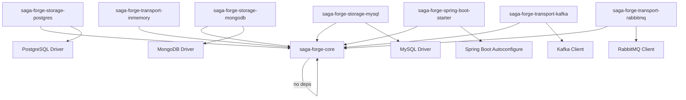
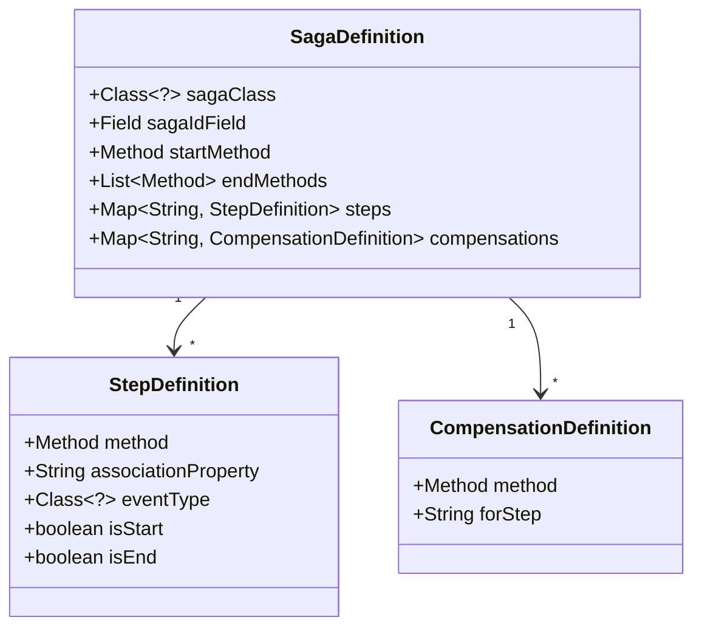

# Design Document: Saga Forge Framework

## Overview

This design covers the foundational layer of Saga Forge: the annotation definitions, multi-module Maven project structure, module dependency boundaries, core interfaces/contracts, and an example saga demonstrating the programming model.

The framework follows an annotation-driven, declarative approach inspired by Axon Framework's saga model. Developers declare sagas as plain Java classes annotated with `@Saga`, define lifecycle boundaries with `@StartSaga`/`@EndSaga`, correlate events to saga instances via `@SagaStep(associationProperty = "...")`, and wire compensation logic with `@SagaCompensation(forStep = "...")`. Domain events and commands are marked with `@DomainEvent` and `@Command` annotations respectively. A step reacts to one domain event and returns `void`; it dispatches zero or more commands through a `CommandGateway` field, and each command is routed to the single `@CommandHandler` for its type (an `@Aggregate` method or constructor, or a service method). Steps do not emit or return commands (updated by `specs/002-transactional-step-sequence`, which supersedes the earlier "step returns a command" flow).

**What is in scope:**
- All 8 original annotation definitions (`@Saga`, `@SagaId`, `@StartSaga`, `@EndSaga`, `@SagaStep`, `@SagaCompensation`, `@DomainEvent`, `@Command`), plus the five added by `specs/002-transactional-step-sequence` (`@CommandHandler`, `@Aggregate`, `@AggregateIdentifier`, `@AggregateLoader`, `@AggregateSaver`)
- `AnnotationScanner` interface and a reflection-based validation implementation, covering a single saga class (`validate`) and a whole model of sagas, handlers, loaders, savers, aggregates, events, and commands (`validateAll`, returning `ValidationReport`)
- Multi-module Maven project structure with parent POM and 5 child modules
- `StorageProvider` and `EventDispatcher` SPI interfaces (contracts only)
- `OrderProcessingSaga` example with domain events and commands

**What is out of scope:**
- Saga engine runtime implementation
- Storage provider implementations (Postgres, MongoDB, MySQL)
- Event transport implementations (in-memory, Kafka, RabbitMQ)
- Spring Boot auto-configuration internals
- Actual pub/sub event delivery implementation

**Key design decisions:**
- Java 24 minimum, leveraging records for immutable event/command types
- All annotations live in `saga-forge-core` with zero external dependencies
- SPI interfaces use Java's `ServiceLoader` pattern for pluggability
- Annotation validation is separated from runtime execution — the `AnnotationScanner` validates at startup, the engine (future spec) executes at runtime
- Steps are `void` event handlers; commands are dispatched through the transport-agnostic `CommandGateway` contract (`io.github.gkosharovdev.sagaforge.core.command`), never returned from a step (`specs/002-transactional-step-sequence` FR-006, FR-007)

## Architecture

### Module Dependency Graph



Event transport modules follow the same pluggable pattern as storage modules: each depends only on `saga-forge-core` and the respective transport client library. The `saga-forge-transport-inmemory` module has no external dependencies beyond core.

### Package Layout

```
saga-forge/
├── pom.xml                              (parent POM, Java 24, module list)
├── saga-forge-core/
│   ├── pom.xml                          (zero external deps)
│   └── src/main/java/io/github/gkosharovdev/sagaforge/
│       ├── core/
│       │   ├── annotation/              (all 13 annotations)
│       │   │   ├── Saga.java
│       │   │   ├── SagaId.java
│       │   │   ├── StartSaga.java
│       │   │   ├── EndSaga.java
│       │   │   ├── SagaStep.java
│       │   │   ├── SagaCompensation.java
│       │   │   ├── DomainEvent.java
│       │   │   ├── Command.java
│       │   │   ├── CommandHandler.java       (spec 002)
│       │   │   ├── Aggregate.java            (spec 002)
│       │   │   ├── AggregateIdentifier.java  (spec 002)
│       │   │   ├── AggregateLoader.java      (spec 002)
│       │   │   └── AggregateSaver.java       (spec 002)
│       │   ├── command/                 (CommandGateway contract, spec 002)
│       │   ├── scanner/                 (annotation validation)
│       │   │   ├── AnnotationScanner.java        (interface)
│       │   │   ├── SagaValidationResult.java     (per-class validation result)
│       │   │   ├── ValidationReport.java         (whole-model result, spec 002)
│       │   │   └── ReflectiveAnnotationScanner.java (implementation)
│       │   └── spi/                     (contracts for future modules)
│       │       ├── StorageProvider.java
│       │       ├── EventDispatcher.java
│       │       └── SagaInstance.java
│       └── test/java/...               (unit + property tests)
├── saga-forge-storage-postgres/
│   ├── pom.xml                          (depends: core + pg driver)
│   └── src/main/java/...               (future spec)
├── saga-forge-storage-mongodb/
│   ├── pom.xml                          (depends: core + mongo driver)
│   └── src/main/java/...               (future spec)
├── saga-forge-storage-mysql/
│   ├── pom.xml                          (depends: core + mysql driver)
│   └── src/main/java/...               (future spec)
├── saga-forge-spring-boot-starter/
│   ├── pom.xml                          (depends: core + spring-boot-autoconfigure)
│   └── src/main/java/...               (future spec)
└── saga-forge-example/
    ├── pom.xml                          (depends: core)
    └── src/main/java/io/github/gkosharovdev/sagaforge/example/
        ├── OrderProcessingSaga.java     (void steps + CommandGateway field, per spec 002)
        ├── events/
        │   ├── OrderCreatedEvent.java
        │   ├── PaymentProcessedEvent.java
        │   └── OrderCompletedEvent.java
        └── commands/
            ├── ProcessPaymentCommand.java
            ├── ReserveStockCommand.java
            └── RequestDeliveryCommand.java
```

The example layout above predates `specs/002-transactional-step-sequence`; that feature adds the example's `@CommandHandler`, `@Aggregate`, `@AggregateLoader`, and `@AggregateSaver` types. The module source is the current file list.

### Design Rationale

1. **Annotations in core, zero deps**: The `saga-forge-core` module has no transitive dependencies. Consumers who only need annotations (e.g., for compile-time checking) pull in nothing extra. This follows the Effective Java principle of minimizing dependencies.

2. **SPI interfaces over abstract classes**: `StorageProvider` and `EventDispatcher` are interfaces, not abstract classes. This allows storage modules to extend database-specific base classes while implementing the SPI contract. Follows Interface Segregation (SOLID).

3. **Validation separated from execution**: The `AnnotationScanner` validates annotation correctness at startup (this spec). The saga engine executes sagas at runtime (future spec). This separation follows Single Responsibility (SOLID) and makes the scanner independently testable.

4. **Records for events and commands**: Java records are ideal for `@DomainEvent` and `@Command` types — they're immutable, have built-in `equals`/`hashCode`, and clearly communicate value semantics.

5. **Example module as a separate Maven module**: The `saga-forge-example` module depends only on `saga-forge-core` and serves as both documentation and a compile-time validation that the annotation model works end-to-end.

6. **EventDispatcher is transport-agnostic (locality decoupling)**: The `EventDispatcher` SPI makes zero assumptions about whether the event publisher and the target saga instance are co-located in the same JVM. This is a deliberate architectural decision. In a single-instance deployment, an in-memory `EventDispatcher` implementation routes events directly via method invocation. In a distributed deployment, a broker-backed implementation (Kafka, RabbitMQ) serializes the domain event, publishes it to a topic/queue, and a consumer on the instance hosting the target saga deserializes and delivers it. The SPI contract is identical in both cases — only the transport changes. This mirrors how `StorageProvider` decouples persistence from the storage backend. Concrete transport implementations (`saga-forge-transport-inmemory`, `saga-forge-transport-kafka`, `saga-forge-transport-rabbitmq`) are separate modules addressed in future specs.

## Components and Interfaces

### Annotations

All annotations reside in `io.github.gkosharovdev.sagaforge.core.annotation`.

#### @Saga
```java
@Target(ElementType.TYPE)
@Retention(RetentionPolicy.RUNTIME)
@Documented
public @interface Saga {
}
```
Marks a class as a saga definition. Only concrete classes (not interfaces or abstract classes) are valid targets. The `AnnotationScanner` enforces this constraint.

#### @SagaId
```java
@Target(ElementType.FIELD)
@Retention(RetentionPolicy.RUNTIME)
@Documented
public @interface SagaId {
}
```
Marks exactly one `String` field per `@Saga` class as the saga instance identity. The scanner validates cardinality (exactly one) and type (`String`).

#### @StartSaga
```java
@Target(ElementType.METHOD)
@Retention(RetentionPolicy.RUNTIME)
@Documented
public @interface StartSaga {
}
```
Marks the method that creates a new saga instance. Must co-occur with `@SagaStep`. Exactly one per saga class.

#### @EndSaga
```java
@Target(ElementType.METHOD)
@Retention(RetentionPolicy.RUNTIME)
@Documented
public @interface EndSaga {
}
```
Marks a method that terminates a saga instance. Must co-occur with `@SagaStep`. At least one per saga class.

#### @StartCompensation
```java
@Target(ElementType.METHOD)
@Retention(RetentionPolicy.RUNTIME)
@Documented
public @interface StartCompensation {
}
```
Marks the step that handles a business-failure event (`specs/006-saga-compensation` FR-001). Must co-occur with `@SagaStep` and never with `@StartSaga` or `@EndSaga` (R20). Its method name is the failure outcome recorded in the instance's `CompensationTrigger`, the way an `@EndSaga` step's name is the success outcome. When its unit of work commits, the instance enters `COMPENSATING` and the engine compensates every other completed step, most recently completed first. Zero or more per saga class; R3 still requires at least one `@EndSaga`.

#### @SagaStep
```java
@Target(ElementType.METHOD)
@Retention(RetentionPolicy.RUNTIME)
@Documented
public @interface SagaStep {
    String associationProperty();
    RetryPolicy retry() default @RetryPolicy;   // specs/005-step-retry
}
```
Marks an event-handling method. The `associationProperty` names the field on the incoming `@DomainEvent` class used to correlate the event to the correct saga instance. The method must accept exactly one parameter whose type is annotated with `@DomainEvent`, must return `void` (commands are dispatched through the saga's `CommandGateway` field), and no two `@SagaStep` methods of one saga may react to the same event type (`specs/002-transactional-step-sequence` FR-001, FR-006).

`retry` declares how often the engine may run the step's unit of work and how long it waits in between (`specs/005-step-retry` FR-011). The default is one attempt, so a step without a policy behaves as before 005.

#### @RetryPolicy
```java
@Target({})
@Retention(RetentionPolicy.RUNTIME)
@Documented
public @interface RetryPolicy {
    int maxAttempts() default 1;                         // attempts including the first, >= 1
    long initialBackoffMillis() default 0;               // wait before attempt 2, >= 0
    double multiplier() default 1.0;                     // growth per further attempt, >= 1.0 (1.0 = fixed)
    long maxBackoffMillis() default 0;                   // cap on one wait; 0 = same as initialBackoffMillis
    Class<? extends Throwable>[] retryOn() default {};   // unmarked failure types treated as transient
}
```
Used only as the value of `@SagaStep.retry`. Framework-owned primitive data, not an alias of a third-party retry annotation (Constitution Principle II). The wait before attempt `k >= 2` is `min(initialBackoffMillis * multiplier^(k-2), cap)`. Which failures are retried is decided with the core markers `TransientFailure` / `FinalFailure` and `retryOn` (`specs/005-step-retry/contracts/retry-policy.md`); the total wait is bounded by the engine at startup, which the scanner cannot check.

#### @SagaCompensation
```java
@Target(ElementType.METHOD)
@Retention(RetentionPolicy.RUNTIME)
@Documented
public @interface SagaCompensation {
    String forStep();
}
```
Marks a compensation handler. The `forStep` attribute references the method name of the `@SagaStep` to compensate. The scanner validates that the referenced method exists and is annotated with `@SagaStep` (R6). Since `specs/006-saga-compensation` the method returns `void`, declares no parameter or one parameter of type `core.compensation.CompensationTrigger`, and is not itself a `@SagaStep` (R21); at most one compensation targets a step, and none targets a `@StartCompensation` step (R22). The engine runs it, in its own saga-scoped unit of work, when the saga compensates after the targeted step committed (`specs/006-saga-compensation/contracts/compensation-run.md`).

#### @DomainEvent
```java
@Target(ElementType.TYPE)
@Retention(RetentionPolicy.RUNTIME)
@Documented
public @interface DomainEvent {
    Class<?> aggregate();
}
```
Marks a domain event class. The required `aggregate` attribute names the event's aggregate type, which must be annotated with `@Aggregate`, and the event type must declare exactly one `@AggregateIdentifier` field (`specs/002-transactional-step-sequence` FR-008, FR-014; this supersedes the earlier attribute-less marker). The scanner validates that `@SagaStep` method parameters are annotated with this.

#### @Command
```java
@Target(ElementType.TYPE)
@Retention(RetentionPolicy.RUNTIME)
@Documented
public @interface Command {
    CommandDelivery delivery() default CommandDelivery.IN_UNIT_OF_WORK;
}

public enum CommandDelivery { IN_UNIT_OF_WORK, OUTBOX }
```
Marker annotation for command classes. A step dispatches a command through the `CommandGateway` (`void send(Object command)`), which routes it to the single `@CommandHandler` for its type; steps do not return commands. A command type declares at most one `@AggregateIdentifier` field, and exactly one when it is handled by an `@Aggregate` instance method (`specs/002-transactional-step-sequence` FR-006, FR-007, FR-011, FR-014).

`delivery` (`specs/007-in-memory-transport` FR-010): `IN_UNIT_OF_WORK` (default) runs the handler synchronously inside the sender's unit of work, as above. `OUTBOX` makes `send` store the command in the unit of work's `Outbox` instead, with the `CommandId` assigned at send time; it is handled after that unit of work commits, in a unit of work of its own, through `CommandReceiver` (Property 35). A outbox command whose type has no handler fails at `send` (`NoCommandHandlerException`) and, for types visible to `validateAll`, at validation (R23).

#### @CommandHandler
```java
@Target({ElementType.METHOD, ElementType.CONSTRUCTOR})
@Retention(RetentionPolicy.RUNTIME)
@Documented
public @interface CommandHandler {
}
```
Marks the handler of one command type (`specs/002-transactional-step-sequence` FR-009 to FR-011). It may sit on an `@Aggregate` instance method (the target aggregate is loaded first), an `@Aggregate` constructor or static factory method (a creation handler), or a method of a non-aggregate service class, but never on a `@Saga` class. A handler declares exactly one `@Command`-typed parameter (other parameters are permitted), and each command type has at most one handler across the validated model.

#### @Aggregate
```java
@Target(ElementType.TYPE)
@Retention(RetentionPolicy.RUNTIME)
@Documented
public @interface Aggregate {
}
```
Marks an aggregate type. It must declare exactly one `@AggregateIdentifier` field (FR-014).

#### @AggregateIdentifier
```java
@Target(ElementType.FIELD)
@Retention(RetentionPolicy.RUNTIME)
@Documented
public @interface AggregateIdentifier {
}
```
Marks the identity field of an `@Aggregate`, `@DomainEvent`, or `@Command` type: exactly one on aggregates and events, at most one on commands (FR-014). Record components annotated with it count through their backing field.

#### @AggregateLoader
```java
@Target(ElementType.METHOD)
@Retention(RetentionPolicy.RUNTIME)
@Documented
public @interface AggregateLoader {
}
```
Marks a client-owned method that loads an aggregate by its identifier: exactly one parameter, returning an `@Aggregate` type; at most one loader per aggregate type (FR-013, FR-014). No Saga Forge type has to be implemented or extended.

#### @AggregateSaver
```java
@Target(ElementType.METHOD)
@Retention(RetentionPolicy.RUNTIME)
@Documented
public @interface AggregateSaver {
}
```
Marks a client-owned method that saves an aggregate: exactly one `@Aggregate`-typed parameter; at most one saver per aggregate type (FR-013, FR-014).

### AnnotationScanner Interface

```java
package io.github.gkosharovdev.sagaforge.core.scanner;

/**
 * Validates saga class definitions against the annotation model rules.
 * Implementations discover and validate @Saga-annotated classes at startup.
 */
public interface AnnotationScanner {

    /**
     * Validates a single saga class against all annotation rules.
     *
     * @param sagaClass the class annotated with @Saga
     * @return validation result containing any errors found
     * @throws IllegalArgumentException if sagaClass is null
     */
    SagaValidationResult validate(Class<?> sagaClass);

    /**
     * Validates a whole model (sagas, handler/loader/saver hosts, aggregates, events, commands)
     * in one pass, reporting all errors rather than stopping at the first (spec 002 FR-026).
     *
     * @throws IllegalArgumentException if classes is null or contains a null element
     */
    ValidationReport validateAll(Collection<Class<?>> classes);
}
```

`validateAll` validates the passed-in classes followed by the `@Aggregate`, `@DomainEvent`, and `@Command` types reached from their signatures (`@SagaStep` parameters, `@CommandHandler` `@Command` parameters, `@AggregateLoader` return types, `@AggregateSaver` parameters). Each class is validated once:

- each passed-in `@Saga` class gets every `validate(Class<?>)` rule;
- each passed-in non-saga class declaring a `@CommandHandler`, `@AggregateLoader`, or `@AggregateSaver` (a host) gets the handler, loader, and saver rules;
- every `@Aggregate`, `@DomainEvent`, and `@Command` type, passed in or reached, gets the identifier rules. Reached types get only these rules, their own signatures are not followed, and `@DomainEvent.aggregate()` is checked but not followed;
- cross-class rules (one handler per command, one loader and one saver per aggregate, identifier on commands of aggregate instance handlers) are evaluated over the passed-in hosts and reported as model errors.

Every passed-in saga and host gets a `SagaValidationResult`, even when valid; other aggregate, event, or command types get one only when they have errors. Classes no rule applies to are ignored.

### ValidationReport

```java
package io.github.gkosharovdev.sagaforge.core.scanner;

/**
 * Immutable result of validateAll: one result per validated class plus cross-class errors.
 */
public record ValidationReport(
    List<SagaValidationResult> classResults,
    List<String> modelErrors
) {
    // Rejects null lists and null elements (IllegalArgumentException); copies both lists.

    public boolean isValid() {  // every class result valid and modelErrors empty
        ...
    }

    public List<String> allErrors() {  // class errors in result order, then model errors
        ...
    }
}
```

### SagaValidationResult

```java
package io.github.gkosharovdev.sagaforge.core.scanner;

import java.util.List;

/**
 * Immutable result of validating a @Saga-annotated class.
 *
 * @param sagaClass  the validated class
 * @param errors     list of validation error messages (empty if valid)
 */
public record SagaValidationResult(
    Class<?> sagaClass,
    List<String> errors
) {
    public SagaValidationResult {
        errors = List.copyOf(errors);
    }

    public boolean isValid() {
        return errors.isEmpty();
    }
}
```

### ReflectiveAnnotationScanner

The concrete implementation uses Java reflection to validate all annotation rules:

**Validation rules enforced (mapped to requirements):**

| Rule | Requirement | Description |
|------|-------------|-------------|
| R1 | 1.3, 1.4 | Class must be annotated with `@Saga`, must be concrete (not interface/abstract) |
| R2 | 2.3, 2.4 | Exactly one `@SagaId` field of type `String` |
| R3 | 3.3, 3.4 | Exactly one `@StartSaga` method, at least one `@EndSaga` method |
| R4 | 3.5, 3.6, 3.7 | `@StartSaga`/`@EndSaga` methods must also have `@SagaStep` |
| R5 | 4.4, 4.5, 4.6 | `@SagaStep` methods: exactly one param, param type annotated with `@DomainEvent` |
| R6 | 5.4, 5.5 | `@SagaCompensation.forStep` references existing `@SagaStep` method |
| R7 | — (feature spec `specs/001-core-lifecycle-context` FR-008) | At most one field whose declared type is `SagaContext` (optional; recognized by declared type only, no marker annotation) |
| R8 | — (`specs/002-transactional-step-sequence` FR-006) | Every `@SagaStep` method returns `void` |
| R9 | — (spec 002 FR-001) | No two `@SagaStep` methods of one saga react to the same event type (only single-parameter steps are compared) |
| R10 | — (spec 002 FR-010) | A `@Saga` class declares no `@CommandHandler` method |
| R11 | — (spec 002 FR-007, research §1) | At most one field whose declared type is `CommandGateway` on a `@Saga` class (optional; recognized by declared type only) |
| R12 | — (spec 002 FR-009) | Each `@CommandHandler` method or constructor declares exactly one `@Command`-typed parameter (host rule, `validateAll` only) |
| R13 | — (spec 002 FR-011) | No `@Command` type is handled by more than one `@CommandHandler` across the model (model rule, `validateAll` only) |
| R14 | — (spec 002 FR-014) | Exactly one `@AggregateIdentifier` field on each `@Aggregate` and `@DomainEvent` type; at most one on each `@Command` type (`validateAll` only) |
| R15 | — (spec 002 FR-014) | A command handled by a non-static `@Aggregate` method declares an `@AggregateIdentifier` field (model rule, `validateAll` only) |
| R16 | — (spec 002 FR-014) | `@DomainEvent(aggregate = X.class)` names a class annotated `@Aggregate` (`validateAll` only) |
| R17 | — (spec 002 FR-013) | `@AggregateLoader`: exactly one parameter, returns an `@Aggregate` type; `@AggregateSaver`: exactly one `@Aggregate`-typed parameter (host rule, `validateAll` only) |
| R18 | — (spec 002 FR-014) | At most one well-formed `@AggregateLoader` and one well-formed `@AggregateSaver` per aggregate type (model rule, `validateAll` only) |
| R19 | — (`specs/005-step-retry` FR-012) | Every `@SagaStep.retry` policy is valid: `maxAttempts >= 1`; `initialBackoffMillis >= 0`; `multiplier` finite and `>= 1.0`; `maxBackoffMillis` is `0` or `>= initialBackoffMillis`; `retryOn` names no `java.lang.Error` type; with `maxAttempts == 1` every other attribute keeps its default |
| R20 | — (`specs/006-saga-compensation` FR-001a) | `@StartCompensation` methods also carry `@SagaStep` and carry neither `@StartSaga` nor `@EndSaga` |
| R21 | — (`specs/006-saga-compensation` FR-009, FR-010) | `@SagaCompensation` methods return `void`, declare no parameter or exactly one parameter of type `CompensationTrigger`, and are not `@SagaStep` methods |
| R22 | — (`specs/006-saga-compensation` FR-008) | At most one `@SagaCompensation` targets a given step, and none targets a `@StartCompensation` step |
| R23 | — (`specs/007-in-memory-transport` FR-010) | Each `@Command(delivery = OUTBOX)` type among the classes passed to `validateAll` is handled by a `@CommandHandler` of a passed-in host (model rule, `validateAll` only; R13 already rejects more than one) |

R1 to R11 and R19 to R22 run in `validate(Class<?>)` and, for each passed-in `@Saga` class, in `validateAll`. R12 to R18 and R23 run only in `validateAll`.

```java
package io.github.gkosharovdev.sagaforge.core.scanner;

import io.github.gkosharovdev.sagaforge.core.annotation.*;
import java.lang.reflect.*;
import java.util.*;

public class ReflectiveAnnotationScanner implements AnnotationScanner {

    @Override
    public SagaValidationResult validate(Class<?> sagaClass) {
        Objects.requireNonNull(sagaClass, "sagaClass must not be null");
        List<String> errors = new ArrayList<>();

        validateClassLevel(sagaClass, errors);
        validateSagaIdField(sagaClass, errors);
        validateSagaContextField(sagaClass, errors);
        validateCommandGatewayField(sagaClass, errors);                    // R11
        Map<String, Method> stepMethods = validateSagaSteps(sagaClass, errors);
        validateStepReturnTypes(sagaClass, stepMethods, errors);           // R8
        validateUniqueStepEventTypes(sagaClass, stepMethods, errors);      // R9
        validateNoCommandHandlers(sagaClass, errors);                      // R10
        validateLifecycle(sagaClass, errors);
        validateCompensation(sagaClass, stepMethods, errors);
        validateRetryPolicies(sagaClass, stepMethods, errors);             // R19
        validateStartCompensation(sagaClass, errors);                      // R20
        validateCompensationShape(sagaClass, errors);                      // R21
        validateCompensationTargets(sagaClass, stepMethods, errors);       // R22

        return new SagaValidationResult(sagaClass, errors);
    }

    @Override
    public ValidationReport validateAll(Collection<Class<?>> classes) {
        // Passed-in classes, then @Aggregate/@DomainEvent/@Command types reached from signatures.
        // Per class: @Saga -> validate(type); host -> validateCommandHandlerParameters (R12),
        //   validateLoaders / validateSavers (R17); every model type -> validateIdentifierFields (R14),
        //   validateEventAggregate (R16).
        // Model errors over the passed-in hosts:
        //   validateUniqueCommandHandlers (R13), validateUniqueAggregateMembers for loaders and savers (R18),
        //   validateInstanceHandlerCommandIdentifiers (R15), validateOutboxCommands (R23).
        return new ValidationReport(classResults, modelErrors);
    }

    // Each private method validates one rule group.
    // Implementation details follow the validation rules table above.
}
```

### SPI Interfaces (Contracts Only)

These interfaces define the contracts that storage and event transport modules will implement in future specs. Both `StorageProvider` and `EventDispatcher` follow the same pluggable module pattern: the SPI is defined in `saga-forge-core`, and concrete implementations live in separate modules.

#### StorageProvider
```java
package io.github.gkosharovdev.sagaforge.core.spi;

import java.util.Optional;

/**
 * SPI for durable saga instance persistence.
 * Implementations are provided by storage modules (postgres, mongodb, mysql).
 */
public interface StorageProvider {

    void save(SagaInstance instance);

    Optional<SagaInstance> findById(String sagaId);

    List<SagaInstance> findByAssociation(String associationProperty, String associationValue);

    void delete(String sagaId);
}
```

#### EventDispatcher
```java
package io.github.gkosharovdev.sagaforge.core.spi;

/**
 * SPI for pub/sub event delivery to saga instances.
 *
 * <p>This interface is <strong>transport-agnostic</strong>. It makes no assumptions about
 * whether the event publisher and the target saga instance reside in the same JVM process.
 * Implementations may deliver events in-process (e.g., direct method invocation for
 * single-instance deployments) or across instances via a message broker (e.g., Kafka,
 * RabbitMQ for distributed deployments).</p>
 *
 * <h3>Implementor concerns</h3>
 * <ul>
 *   <li><strong>Serialization</strong>: Distributed implementations must handle serialization
 *       and deserialization of domain event objects for cross-instance transport.</li>
 *   <li><strong>Event routing</strong>: Implementations must route events to the correct saga
 *       instance based on association property correlation, regardless of which application
 *       instance hosts that saga.</li>
 *   <li><strong>Delivery semantics</strong>: Implementations should document their delivery
 *       guarantees (at-least-once, exactly-once). The SPI does not prescribe a specific
 *       delivery semantic — this is a transport-level concern.</li>
 * </ul>
 */
public interface EventDispatcher {

    void dispatch(Object domainEvent);

    void registerSagaType(Class<?> sagaClass);
}
```

#### SagaInstance
```java
package io.github.gkosharovdev.sagaforge.core.spi;

import java.time.Instant;
import java.util.Map;

/**
 * Represents a running saga instance's persisted state.
 *
 * @param sagaId           unique identifier
 * @param sagaType         fully qualified class name of the @Saga class
 * @param state            serialized saga field state
 * @param associations     association property -> value mappings
 * @param status           current lifecycle status
 * @param createdAt        creation timestamp
 * @param lastModifiedAt   last state transition timestamp
 */
public record SagaInstance(
    String sagaId,
    String sagaType,
    Map<String, Object> state,
    Map<String, String> associations,
    SagaStatus status,
    Instant createdAt,
    Instant lastModifiedAt
) {
    public SagaInstance {
        state = Map.copyOf(state);
        associations = Map.copyOf(associations);
    }
}
```

#### SagaStatus
```java
package io.github.gkosharovdev.sagaforge.core.spi;

public enum SagaStatus {
    CREATED,
    RUNNING,
    COMPENSATING,            // compensations running (specs/006-saga-compensation)
    COMPLETED,
    FAILED,
    COMPENSATED,             // terminal: every applicable compensation committed (006)
    REQUIRES_INTERVENTION    // terminal: a compensation failed; never retried (006)
}
```

`COMPLETED`, `FAILED`, `COMPENSATED` and `REQUIRES_INTERVENTION` are terminal. `SagaInstance.compensationTrigger` is
non-null if and only if the status is `COMPENSATING`, `COMPENSATED` or `REQUIRES_INTERVENTION`
(`specs/006-saga-compensation/data-model.md`).

## Data Models

### Annotation Metadata (Internal to Scanner)

The `ReflectiveAnnotationScanner` builds an internal model during validation. This model is not persisted — it exists only during the validation pass.



This internal model is a natural byproduct of validation. Future specs (saga engine) can reuse it for runtime dispatch, but that's out of scope here.

### SagaInstance Persistence Model

The `SagaInstance` record (defined in the SPI section above) is the persistence contract. Storage providers serialize/deserialize this record. Key fields:

- `sagaId` — the value from the `@SagaId` field, used as the primary key
- `sagaType` — FQCN of the `@Saga` class, used for deserialization
- `state` — a `Map<String, Object>` snapshot of all saga fields (serialized by the engine)
- `associations` — maps `associationProperty` names to their current values, used for event correlation lookups
- `status` — lifecycle state tracked via `SagaStatus` enum
- `createdAt` / `lastModifiedAt` — timestamps for auditing and ordering


## Correctness Properties

*A property is a characteristic or behavior that should hold true across all valid executions of a system — essentially, a formal statement about what the system should do. Properties serve as the bridge between human-readable specifications and machine-verifiable correctness guarantees.*

### Property 1: SagaId cardinality enforcement

*For any* `@Saga`-annotated class, the `AnnotationScanner` shall report a validation error if and only if the class does not contain exactly one `@SagaId`-annotated field of type `String`. Equivalently: for any saga class with zero, or two or more `@SagaId` fields, or a `@SagaId` field of non-`String` type, `validate()` must return a result where `isValid()` is `false` and `errors` contains a message about `@SagaId`.

**Validates: Requirements 2.3, 2.4**

### Property 2: Lifecycle method cardinality enforcement

*For any* `@Saga`-annotated class, the `AnnotationScanner` shall report a validation error if the class does not contain exactly one `@StartSaga`-annotated method or does not contain at least one `@EndSaga`-annotated method. For any saga class violating either cardinality constraint, `validate()` must return `isValid() == false`.

**Validates: Requirements 3.3, 3.4**

### Property 3: Lifecycle annotations require @SagaStep co-occurrence

*For any* method annotated with `@StartSaga` or `@EndSaga` within a `@Saga`-annotated class, if that method is not also annotated with `@SagaStep`, then the `AnnotationScanner` shall report a validation error. Conversely, if all lifecycle-annotated methods also carry `@SagaStep`, this rule produces no errors.

**Validates: Requirements 3.5, 3.6, 3.7**

### Property 4: SagaStep parameter validation

*For any* `@SagaStep`-annotated method within a `@Saga`-annotated class, the `AnnotationScanner` shall report a validation error if the method does not accept exactly one parameter, or if that parameter's type is not annotated with `@DomainEvent`. For any saga class where all `@SagaStep` methods have exactly one `@DomainEvent`-annotated parameter, this rule produces no errors.

**Validates: Requirements 4.4, 4.5, 4.6**

### Property 5: SagaCompensation forStep reference validity

*For any* `@SagaCompensation`-annotated method within a `@Saga`-annotated class, the `AnnotationScanner` shall report a validation error if the `forStep` attribute references a method name that either does not exist in the class or exists but is not annotated with `@SagaStep`. For any saga class where all `@SagaCompensation.forStep` values reference valid `@SagaStep` method names, this rule produces no errors.

**Validates: Requirements 5.4, 5.5**

### Property 6: Valid saga classes pass validation

*For any* `@Saga`-annotated class that satisfies all structural rules (concrete class, exactly one `@SagaId` String field, exactly one `@StartSaga` method, at least one `@EndSaga` method, all lifecycle methods co-annotated with `@SagaStep`, all `@SagaStep` methods with exactly one `@DomainEvent` parameter, all `@SagaCompensation.forStep` referencing valid `@SagaStep` methods), the `AnnotationScanner.validate()` shall return a `SagaValidationResult` where `isValid()` is `true` and `errors` is empty.

**Validates: Requirements 1.3, 2.3, 3.3, 3.4, 3.5, 3.6, 4.4, 5.4, 5.5**

This property still holds for saga classes declaring zero or one `SagaContext`-typed field: the `SagaContext` field is optional (see Property 9), so a class satisfying all of the rules above with zero or one such field is valid.

This property still holds under the rules added by `specs/002-transactional-step-sequence` (Properties 10 to 13), with "structurally valid" extended accordingly: a saga class that also has only `void` `@SagaStep` methods, no two `@SagaStep` methods reacting to the same event type, no `@CommandHandler` method, and zero or one `CommandGateway`-typed field passes `validate()` with no errors, and `validateAll` reports no errors for it either, provided the event types its steps reach also satisfy Properties 16 and 17.

### Property 7: Non-concrete saga classes are rejected

*For any* class annotated with `@Saga` that is an interface or an abstract class, the `AnnotationScanner` shall report a validation error. `validate()` must return `isValid() == false` with an error message indicating the class must be concrete.

**Validates: Requirements 1.4**

### Property 8: SagaValidationResult immutability

*For any* `SagaValidationResult` instance, the `errors` list shall be unmodifiable. Attempting to mutate the list (add, remove, clear) shall throw `UnsupportedOperationException`. This holds regardless of the input list passed to the constructor.

**Validates: Requirements 1.3, 2.3 (general correctness — validation results must be trustworthy and immutable)**

### Property 9: SagaContext field cardinality enforcement

*For any* `@Saga`-annotated class, the `AnnotationScanner` shall report a validation error if and only if the class declares more than one field whose declared type is `io.github.gkosharovdev.sagaforge.core.lifecycle.SagaContext`. The field is recognized by its declared type only (no marker annotation), and it is optional: zero or one such field is valid. Equivalently: for any saga class with two or more `SagaContext`-typed fields, `validate()` must return a result where `isValid()` is `false` and `errors` contains a message about the `SagaContext` field count; for any saga class with zero or one such field, this rule produces no errors.

**Validates: Feature spec `specs/001-core-lifecycle-context` FR-008 (no corresponding requirement in this spec's `requirements.md`)**

Properties 10 to 20 are added by feature spec `specs/002-transactional-step-sequence` (rules R8 to R18). Properties 10 to 13 are saga-class rules checked by both `validate()` and `validateAll()`; Properties 14 to 20 are checked only by `validateAll()`, either per class or as model errors in `ValidationReport.modelErrors()`. Every one of them is reported in the same single pass as all other rules (spec 002 FR-026).

### Property 10: SagaStep methods return void

*For any* `@Saga`-annotated class, the `AnnotationScanner` shall report a validation error for each `@SagaStep`-annotated method whose return type is not `void`, and no error from this rule if every `@SagaStep` method returns `void`. Equivalently: for any saga class with a `@SagaStep` method returning a value, `validate()` must return a result where `isValid()` is `false` and `errors` contains a message naming that method and directing the developer to dispatch commands through the `CommandGateway`.

**Validates: Feature spec `specs/002-transactional-step-sequence` FR-006 (supersedes this spec's Requirement 8.4 and Requirement 11)**

### Property 11: Event type uniqueness per saga

*For any* `@Saga`-annotated class, the `AnnotationScanner` shall report exactly one validation error per event type that is the single parameter type of two or more `@SagaStep`-annotated methods, and no error from this rule if every such parameter type is distinct. The error names the event type and lists the offending method names in ascending lexicographic order; steps that do not have exactly one parameter are not compared (they are reported by Property 4).

**Validates: Feature spec `specs/002-transactional-step-sequence` FR-001**

### Property 12: No command handlers on a saga

*For any* `@Saga`-annotated class, the `AnnotationScanner` shall report a validation error for each declared method annotated with `@CommandHandler`, and no error from this rule if the class declares no such method.

**Validates: Feature spec `specs/002-transactional-step-sequence` FR-010**

### Property 13: CommandGateway field cardinality enforcement

*For any* `@Saga`-annotated class, the `AnnotationScanner` shall report a validation error if and only if the class declares more than one field whose declared type is `io.github.gkosharovdev.sagaforge.core.command.CommandGateway`. The field is recognized by its declared type only (no marker annotation), and it is optional: zero or one such field is valid, and for two or more `errors` contains a message with the field count.

**Validates: Feature spec `specs/002-transactional-step-sequence` FR-007 and research §1**

### Property 14: Exactly one command parameter per handler

*For any* class passed to `validateAll()` that is not a `@Saga` class, the `AnnotationScanner` shall report a validation error in that class's result for each `@CommandHandler`-annotated method or constructor that does not declare exactly one parameter whose type is annotated with `@Command`, and no error from this rule if every handler declares exactly one. Parameters of other types are permitted and not counted.

**Validates: Feature spec `specs/002-transactional-step-sequence` FR-009**

### Property 15: One handler per command type

*For any* set of classes passed to `validateAll()`, the `AnnotationScanner` shall report exactly one model error per `@Command` type handled by two or more `@CommandHandler` methods or constructors across the passed-in non-saga classes, and no error from this rule if every command type has at most one handler. Only handlers with exactly one `@Command` parameter take part (others are reported by Property 14). The error lists the handlers as `{class}.{member}` in ascending lexicographic order.

**Validates: Feature spec `specs/002-transactional-step-sequence` FR-011**

### Property 16: AggregateIdentifier cardinality enforcement

*For any* `@Aggregate` or `@DomainEvent` type validated by `validateAll()` (passed in or reached from a step, handler, loader, or saver signature), the `AnnotationScanner` shall report a validation error if and only if the type does not declare exactly one `@AggregateIdentifier` field; *for any* `@Command` type so validated, it shall report a validation error if and only if the type declares more than one. Only declared fields count; record components count through their backing field.

**Validates: Feature spec `specs/002-transactional-step-sequence` FR-014**

### Property 17: DomainEvent names an aggregate

*For any* `@DomainEvent` type validated by `validateAll()`, the `AnnotationScanner` shall report a validation error if and only if the class named by `@DomainEvent.aggregate()` is not annotated with `@Aggregate`.

**Validates: Feature spec `specs/002-transactional-step-sequence` FR-014**

### Property 18: Commands of aggregate instance handlers declare an identifier

*For any* passed-in `@Aggregate` class with a non-static `@CommandHandler` method declaring exactly one `@Command` parameter, the `AnnotationScanner` shall report a model error if and only if that command type declares no `@AggregateIdentifier` field. Constructors and static factory methods (creation handlers) and service-class handlers are not subject to this rule; a command with several identifiers is reported by Property 16 instead.

**Validates: Feature spec `specs/002-transactional-step-sequence` FR-014 (and FR-013: the identifier is how the target aggregate is loaded)**

### Property 19: AggregateLoader and AggregateSaver shape

*For any* class passed to `validateAll()` that is not a `@Saga` class, the `AnnotationScanner` shall report a validation error for each `@AggregateLoader` method that does not take exactly one parameter or does not return an `@Aggregate`-annotated type, and for each `@AggregateSaver` method that does not take exactly one parameter whose type is annotated with `@Aggregate`. Well-formed loaders and savers produce no error from this rule.

**Validates: Feature spec `specs/002-transactional-step-sequence` FR-013**

### Property 20: One loader and one saver per aggregate type

*For any* set of classes passed to `validateAll()`, the `AnnotationScanner` shall report exactly one model error per aggregate type returned by two or more well-formed `@AggregateLoader` methods, and exactly one per aggregate type taken by two or more well-formed `@AggregateSaver` methods, across the passed-in non-saga classes; no error from this rule if each aggregate type has at most one of each. Malformed members do not take part (they are reported by Property 19). The error lists the members as `{class}.{method}` in ascending lexicographic order.

**Validates: Feature spec `specs/002-transactional-step-sequence` FR-014**

### Property 21: Loader availability at engine start

*For any* registered `@Aggregate` class with a non-static `@CommandHandler` method, `SagaRuntime.start()` shall report an engine error naming that aggregate if and only if no registered class declares an `@AggregateLoader` for it and no registered `AggregateResolver` supports it.

**Validates: Feature spec `specs/004-saga-engine` FR-035** (test: `StartupChecksPropertyTest`)

### Property 22: Handler parameter resolvability at engine start

*For any* parameter of a registered `@CommandHandler` method or constructor other than its `@Command` parameter, `SagaRuntime.start()` shall report an engine error naming the handler and the parameter (`#<position> <SimpleType>`) if and only if no registered `HandlerParameterResolver` supports it.

**Validates: Feature spec `specs/004-saga-engine` FR-019, FR-035** (test: `StartupChecksPropertyTest`)

### Property 23: Saga instantiability at engine start

*For any* registered `@Saga` class, `SagaRuntime.start()` shall report an engine error naming it if and only if a `SagaObjectProvider` is registered and does not support it, or none is registered and the class declares no no-argument constructor.

**Validates: Feature spec `specs/004-saga-engine` FR-035** (test: `StartupChecksPropertyTest`)

### Property 24: Single-pass startup

*For any* registered model and plug-ins, the `StartupReport` thrown by `SagaRuntime.start()` shall contain every `validateAll` error and every error of Properties 21 to 23 at once, and an engine whose report holds any error shall accept zero events, commands and publications.

**Validates: Feature spec `specs/004-saga-engine` FR-034, FR-036, SC-006** (test: `StartupChecksPropertyTest`)

### Property 25: In-process duplicate start

*For any* number of start events with the same saga type and association value handled concurrently by one engine while no active instance has that value, exactly one result shall have `started = true` and every other shall be `DUPLICATE_START` with no saga id.

**Validates: Feature spec `specs/004-saga-engine` FR-027, SC-012** (test: `ConcurrentDuplicateStartTest`)

### Property 26: Outbox obligations

*For any* committed unit of work with buffered events, the `Outbox` (called `EventHandoff` before `specs/007-in-memory-transport`) shall receive exactly those events, once, in recording order, under a `unitOfWorkId` no other unit of work has, with saga type and saga id present if and only if the unit of work is saga-scoped; *for any* rolled-back unit of work it shall receive nothing (with `IN_TRANSACTION` timing, nothing that survives the rollback). Since `specs/008-spring-boot-starter` the batch also carries `recordedEvents`: every event recorded in the unit of work, in recording order, a superset of `events` (it includes events a step of the owning instance ran in process). The `Outbox` receives a batch whenever `events` or `commands` is non-empty, and also when only `recordedEvents` is non-empty if it reports `observesRecordedEvents()`.

**Validates: Feature spec `specs/004-saga-engine` FR-029, FR-030, SC-005, SC-011** (test: `OutboxObligationsPropertyTest`)

### Property 27: Lifecycle history order

*For any* engine-driven saga instance, its persisted lifecycle entries shall be `CREATED`, then for each committed unit of work its `STEP_COMPLETED` entries in completion order followed by `COMPLETED` if that unit of work ended the saga, then `FAILED` if the saga failed; no entry of a rolled-back unit of work shall be persisted. Since `specs/006-saga-compensation`, a compensating instance's entries continue with `COMPENSATION_STARTED`, one `STEP_COMPENSATED` per compensation committed in reverse completion order, and finally either `COMPENSATED` or `COMPENSATION_FAILED` followed by `REQUIRES_INTERVENTION`.

**Validates: Feature spec `specs/004-saga-engine` FR-033, SC-010** (test: `LifecycleHistoryPropertyTest`)

### Property 28: Serialized units of work per instance

*For any* two units of work of one saga instance, run by one engine or by two engines over shared stores, their step executions shall never overlap, and a write-time `SagaConcurrencyConflictException` shall never produce a `FAILED` write.

**Validates: Feature spec `specs/004-saga-engine` FR-025, FR-026, SC-003** (tests: `ConcurrentUnitsOfWorkTest`, `ConcurrencyConflictTest`)

### Property 29: RetryPolicy values validity

*For any* `@SagaStep` method of a `@Saga` class, the `AnnotationScanner` shall report one validation error for each violated rule of R19 on its `retry` policy, and no R19 error for a policy that satisfies all of them (including the default `@RetryPolicy`).

**Validates: Feature spec `specs/005-step-retry` FR-011, FR-012** (test: `RetryPolicyValidationTest`, including the property `retryPolicyValidity`)

### Property 30: StartCompensation placement

*For any* `@Saga` class, the `AnnotationScanner` shall report one error for each `@StartCompensation` method that lacks `@SagaStep`, and one for each that also carries `@StartSaga` or `@EndSaga`, and no R20 error otherwise.

**Validates: Feature spec `specs/006-saga-compensation` FR-001, FR-001a** (test: `StartCompensationValidationTest`, including the property `startCompensationPlacement`)

### Property 31: Compensation method shape

*For any* `@SagaCompensation` method of a `@Saga` class, the `AnnotationScanner` shall report one error if it does not return `void`, one if it declares any parameters other than a single `CompensationTrigger`, and one if it is also a `@SagaStep`, and no R21 error otherwise.

**Validates: Feature spec `specs/006-saga-compensation` FR-009, FR-010** (test: `CompensationValidationTest`, including the property `compensationShape`)

### Property 32: One compensation per step

*For any* `@Saga` class, the `AnnotationScanner` shall report one error for each step targeted by more than one `@SagaCompensation`, and one for each `@SagaCompensation` targeting a `@StartCompensation` step.

**Validates: Feature spec `specs/006-saga-compensation` FR-008** (test: `CompensationValidationTest`)

### Property 33: Compensation selection and order

*For any* engine-driven saga instance that enters compensation, the compensations run shall be exactly those declared for its `COMPLETED` steps other than the triggering `@StartCompensation` step, in decreasing order of completion; a step whose unit of work rolled back shall never be compensated, and a completed step without a compensation shall be recorded `NOTHING_TO_COMPENSATE`.

**Validates: Feature spec `specs/006-saga-compensation` FR-005, FR-007, SC-002** (test: `CompensationSelectionPropertyTest`)

### Property 34: Each compensation at most once

*For any* engine-driven saga instance and any point at which the process stops during compensation, handling a later event for the instance shall commit each remaining compensation exactly once and never run an already committed compensation again (a compensation whose own unit of work the stop rolled back runs again, with the same command identities).

**Validates: Feature spec `specs/006-saga-compensation` FR-004, FR-012, SC-003** (tests: `CompensationResumePropertyTest`, `CompensationFaultInjectionTest`)

### Property 35: Outbox commands

*For any* `@Command(delivery = OUTBOX)` command sent through the `CommandGateway` inside a unit of work, its handler shall not run before that unit of work commits, shall never run if it rolls back (the command reaches the `Outbox` only with a committed batch), and, when run through `CommandReceiver`, shall receive the `CommandId` assigned at send time; a step re-run after a retry or redelivery shall not store the same command again.

**Validates: Feature spec `specs/007-in-memory-transport` FR-010 to FR-012** (tests: `OutboxCommandPropertyTest`, `OutboxCommandTest`)

### Note: `.kiro/specs/saga-context-lifecycle/design.md` and the engine (004)

None of that document's Properties 1 to 12 applies to the engine as written: they describe `getProperty`, `registerProperty` and `setContext`, which do not exist (`.specify/memory/memory.md` G-002-05). Its "Engine-Level Error Handling" rule (clear the context in a `finally`) is honored by `DomainEventScope.runWith`, which restores the previous binding however the work ends. That document is left unchanged (AGENTS.md). Properties 1 to 20 above are unchanged: the engine adds no annotation and no scanner rule. `specs/005-step-retry` adds the `@SagaStep.retry` attribute, rule R19 and Property 29, and leaves Properties 1 to 28 unchanged. `specs/006-saga-compensation` adds `@StartCompensation`, rules R20 to R22 and Properties 30 to 34, extends Property 27 with the compensation entries, and leaves Properties 1 to 26, 28 and 29 unchanged. `specs/007-in-memory-transport` adds `@Command.delivery` (`CommandDelivery`), rule R23 and Property 35, renames the handoff SPI to `Outbox` (Property 26's wording follows), and leaves Properties 1 to 34 otherwise unchanged. `specs/008-spring-boot-starter` extends Property 26 with `recordedEvents` and changes no annotation, rule or other property.

## Error Handling

### Scanner Validation Errors

The `ReflectiveAnnotationScanner` collects all validation errors for a saga class in a single pass rather than failing on the first error. This gives developers a complete picture of what needs fixing. `validateAll` extends the same single pass to a whole model: per-class errors go into each class's `SagaValidationResult`, and cross-class errors (marked "model error" below) go into `ValidationReport.modelErrors()`.

**Error categories and messages:**

| Error Category | Condition | Error Message Pattern |
|---|---|---|
| Non-concrete class | `@Saga` on interface/abstract class | `"@Saga class {className} must be a concrete class, not an interface or abstract class"` |
| Missing @SagaId | Zero `@SagaId` fields | `"@Saga class {className} must declare exactly one @SagaId field, found 0"` |
| Multiple @SagaId | >1 `@SagaId` fields | `"@Saga class {className} must declare exactly one @SagaId field, found {count}"` |
| Wrong @SagaId type | `@SagaId` field not `String` | `"@SagaId field {fieldName} in {className} must be of type String"` |
| Multiple SagaContext | >1 fields of declared type `SagaContext` | `"@Saga class {className} must declare at most one SagaContext field, found {count}"` |
| Missing @StartSaga | Zero `@StartSaga` methods | `"@Saga class {className} must declare exactly one @StartSaga method, found 0"` |
| Multiple @StartSaga | >1 `@StartSaga` methods | `"@Saga class {className} must declare exactly one @StartSaga method, found {count}"` |
| Missing @EndSaga | Zero `@EndSaga` methods | `"@Saga class {className} must declare at least one @EndSaga method, found 0"` |
| Lifecycle without @SagaStep | `@StartSaga`/`@EndSaga` without `@SagaStep` | `"Method {methodName} in {className} is annotated with @{lifecycle} but missing @SagaStep"` |
| Wrong param count | `@SagaStep` method with !=1 params | `"@SagaStep method {methodName} in {className} must accept exactly one parameter, found {count}"` |
| Non-@DomainEvent param | Param type missing `@DomainEvent` | `"@SagaStep method {methodName} parameter type {paramType} must be annotated with @DomainEvent"` |
| Invalid forStep reference | `forStep` references non-existent method | `"@SagaCompensation on {methodName}: forStep '{forStep}' does not reference an existing method in {className}"` |
| forStep not a @SagaStep | `forStep` references non-`@SagaStep` method | `"@SagaCompensation on {methodName}: forStep '{forStep}' must reference a @SagaStep method"` |
| Step returns a value (R8) | `@SagaStep` method with non-`void` return type | `"@SagaStep method {methodName} in {className} must return void; dispatch commands through the CommandGateway instead"` |
| Duplicate step event type (R9) | Two or more single-parameter `@SagaStep` methods on one event type | `"@Saga class {className} has more than one @SagaStep reacting to {eventType}: {methodName}, {methodName}"` |
| Handler on a saga (R10) | `@CommandHandler` method declared on a `@Saga` class | `"@Saga class {className} must not declare @CommandHandler method {methodName}"` |
| Multiple CommandGateway (R11) | >1 fields of declared type `CommandGateway` | `"@Saga class {className} must declare at most one CommandGateway field, found {count}"` |
| Handler command parameter count (R12) | `@CommandHandler` with !=1 `@Command`-typed params | `"@CommandHandler method {methodName} in {className} must declare exactly one @Command parameter, found {count}"` |
| Duplicate handler (R13, model error) | >1 `@CommandHandler` for one `@Command` type | `"Command {commandType} has more than one @CommandHandler: {className}.{methodName}, {className}.{methodName}"` |
| Aggregate or event identifier count (R14) | `@Aggregate`/`@DomainEvent` type without exactly one `@AggregateIdentifier` field | `"{className} must declare exactly one @AggregateIdentifier field, found {count}"` |
| Command identifier count (R14) | `@Command` type with >1 `@AggregateIdentifier` fields | `"@Command type {className} must declare at most one @AggregateIdentifier field, found {count}"` |
| Instance-handler command without identifier (R15, model error) | Command of a non-static `@Aggregate` handler method has no `@AggregateIdentifier` | `"@Command type {commandType} is handled by @Aggregate instance method {className}.{methodName} and must declare an @AggregateIdentifier field"` |
| Event aggregate not an aggregate (R16) | `@DomainEvent.aggregate()` names a non-`@Aggregate` class | `"@DomainEvent type {className} names aggregate {aggregateType}, which is not annotated @Aggregate"` |
| Loader shape (R17) | `@AggregateLoader` with !=1 params or non-`@Aggregate` return type | `"@AggregateLoader method {methodName} in {className} must take exactly one parameter and return an @Aggregate type"` |
| Saver shape (R17) | `@AggregateSaver` without exactly one `@Aggregate`-typed param | `"@AggregateSaver method {methodName} in {className} must take exactly one @Aggregate-typed parameter"` |
| Duplicate loader (R18, model error) | >1 well-formed `@AggregateLoader` for one aggregate type | `"Aggregate {aggregateType} has more than one @AggregateLoader: {className}.{methodName}, {className}.{methodName}"` |
| Duplicate saver (R18, model error) | >1 well-formed `@AggregateSaver` for one aggregate type | `"Aggregate {aggregateType} has more than one @AggregateSaver: {className}.{methodName}, {className}.{methodName}"` |
| Invalid retry policy (R19) | A `@SagaStep.retry` attribute violates R19 | `"@SagaStep method {methodName} in {className} has an invalid retry policy: {attribute} {reason}"` where `{reason}` is one of `must be at least 1, found {value}`, `must not be negative, found {value}`, `must be a finite number of at least 1.0, found {value}`, `must be 0 or at least initialBackoffMillis {initial}, found {value}`, `must not name Error type {typeName}`, `must keep its default when maxAttempts is 1` |
| StartCompensation without @SagaStep (R20) | `@StartCompensation` without `@SagaStep` | `"Method {methodName} in {className} is annotated with @StartCompensation but missing @SagaStep"` |
| StartCompensation with another lifecycle annotation (R20) | `@StartCompensation` with `@StartSaga` or `@EndSaga` | `"@StartCompensation method {methodName} in {className} cannot also be annotated with @{lifecycle}"` |
| Compensation returns a value (R21) | `@SagaCompensation` method with non-`void` return type | `"@SagaCompensation method {methodName} in {className} must return void"` |
| Compensation parameters (R21) | Parameters other than none or one `CompensationTrigger` | `"@SagaCompensation method {methodName} in {className} must declare no parameter or one CompensationTrigger parameter"` |
| Compensation is a step (R21) | `@SagaCompensation` method also `@SagaStep` | `"@SagaCompensation method {methodName} in {className} cannot also be annotated with @SagaStep"` |
| Duplicate compensation (R22) | >1 `@SagaCompensation` for one step | `"@SagaCompensation methods {methodName}, {methodName} in {className} both compensate step {stepName}"` |
| Outbox command without handler (R23, model error) | `@Command(delivery = OUTBOX)` type passed to `validateAll` with no `@CommandHandler` among the passed-in hosts | `"Command {commandType} is delivered through the outbox but has no @CommandHandler"` |
| Compensation of a trigger step (R22) | `forStep` names a `@StartCompensation` step | `"@SagaCompensation method {methodName} in {className} compensates step {stepName}, which is a @StartCompensation step"` |

All class names and type names are simple names. For a `@CommandHandler` constructor, `{methodName}` is the declaring class's simple name. Lists in R9, R13, R18 and R22 messages are sorted in ascending lexicographic order (method names for R9 and R22, full `{className}.{methodName}` strings for R13 and R18), and R9, R13, and R18 emit one error per duplicated type, ordered by the type's simple name.

### Null Safety

- `AnnotationScanner.validate(null)` throws `IllegalArgumentException` immediately
- `AnnotationScanner.validateAll(null)`, or a collection containing a `null` element, throws `IllegalArgumentException` immediately
- `ValidationReport` rejects `null` lists and `null` elements with `IllegalArgumentException` and copies both lists
- `SagaValidationResult` constructor uses `List.copyOf()` to reject null elements and ensure immutability

### SPI Error Contracts (for future implementors)

- `StorageProvider.save(null)` — implementations should throw `IllegalArgumentException`
- `StorageProvider.findById(null)` — implementations should throw `IllegalArgumentException`
- `EventDispatcher.dispatch(null)` — implementations should throw `IllegalArgumentException`
- `EventDispatcher` distributed implementations should handle serialization failures gracefully (e.g., wrap in a transport-specific exception) rather than propagating raw serialization errors to callers

These contracts are documented in Javadoc on the SPI interfaces. Enforcement is the responsibility of each implementation module (future specs).

## Testing Strategy

### Testing Framework

- **Unit testing**: JUnit 5 (Jupiter)
- **Property-based testing**: jqwik (Java property-based testing library, integrates with JUnit 5)
- **Assertions**: AssertJ for fluent assertions

### Dual Testing Approach

Both unit tests and property-based tests are required. They serve complementary purposes:

- **Unit tests** verify specific examples, edge cases, and error messages
- **Property tests** verify universal rules across randomly generated inputs

### Unit Tests

Unit tests focus on concrete examples and edge cases:

1. **Annotation metadata tests** — verify `@Target`, `@Retention`, and attributes for all 8 annotations via reflection (covers Requirements 1.1, 1.2, 2.1, 2.2, 3.1, 3.2, 4.1, 4.2, 4.3, 5.1, 5.2, 5.3, 7.1–7.3, 8.1–8.3)
2. **Example saga integration test** — validate `OrderProcessingSaga` passes the scanner (covers Requirements 12.1–12.9)
3. **Specific error message tests** — verify exact error messages for each validation failure category
4. **Null input tests** — verify `IllegalArgumentException` for null inputs

### Property-Based Tests

Each correctness property maps to a single property-based test. Tests use jqwik to generate randomized saga class structures.

**Generator strategy**: Since we can't generate arbitrary Java classes at runtime, we use a **model-based approach**. We define a `SagaClassModel` that describes the structure of a saga class (number of @SagaId fields, their types, number of @StartSaga methods, etc.). jqwik generates random `SagaClassModel` instances. A test helper uses `ByteBuddy` or pre-built test fixture classes to create actual Java classes matching the model, then runs the scanner against them.

Alternative simpler approach: maintain a set of pre-built test fixture classes (valid and invalid saga classes covering all rule combinations) and use jqwik's `@ForAll` with `@From` to select from them. This is more practical for annotation validation testing.

**Property test configuration:**
- Minimum 100 iterations per property test
- Each test tagged with: `Feature: saga-forge-framework, Property {number}: {property_text}`

**Property test list:**

| Test | Property | Description |
|------|----------|-------------|
| `sagaIdCardinalityEnforcement` | Property 1 | For any saga class with wrong @SagaId count/type, validation fails |
| `lifecycleMethodCardinalityEnforcement` | Property 2 | For any saga class with wrong @StartSaga/@EndSaga counts, validation fails |
| `lifecycleRequiresSagaStepCoOccurrence` | Property 3 | For any lifecycle method without @SagaStep, validation fails |
| `sagaStepParameterValidation` | Property 4 | For any @SagaStep with wrong param count or non-@DomainEvent param, validation fails |
| `compensationForStepReferenceValidity` | Property 5 | For any @SagaCompensation with invalid forStep, validation fails |
| `validSagaClassesPassValidation` | Property 6 | For any structurally valid saga class, validation passes |
| `nonConcreteSagaClassesRejected` | Property 7 | For any interface/abstract @Saga class, validation fails |
| `validationResultImmutability` | Property 8 | For any SagaValidationResult, errors list is unmodifiable |
| `retryPolicyValidity` | Property 29 | For any generated retry policy, R19 errors appear exactly for the violated rules |

Properties 9 to 20 are covered by fixture-based tests with exact error messages: Properties 9 to 13 in `ReflectiveAnnotationScannerTest` (Properties 10 to 13 in its nested `TransactionalStepSequenceRuleTests`), and Properties 14 to 20 in `ValidateAllTest`.

### Test Location

All tests reside in `saga-forge-core/src/test/java/io/github/gkosharovdev/sagaforge/core/`:
- `scanner/ReflectiveAnnotationScannerTest.java` — unit tests
- `scanner/ReflectiveAnnotationScannerPropertyTest.java` — property-based tests
- `scanner/fixtures/` — pre-built test fixture saga classes
- `annotation/AnnotationMetadataTest.java` — annotation reflection tests
- `example/OrderProcessingSagaValidationTest.java` — example integration test
