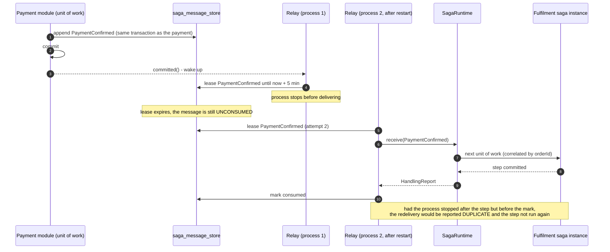
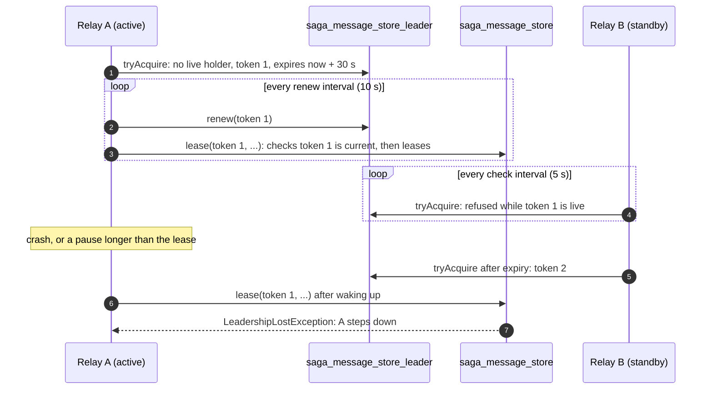
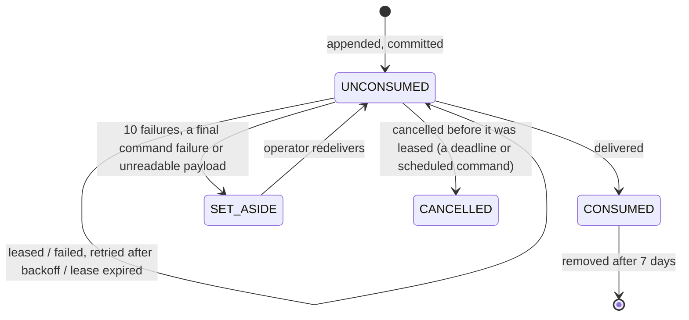

# Architecture

This document describes the target design of Saga Forge: what is built today, what is planned, and the
reasoning behind the boundaries between modules. See the root [README.md](../README.md) for the pitch and
[use-cases.md](use-cases.md) for worked examples.

## Status at a glance

| Layer | State |
|---|---|
| Annotation model (`@Saga`, `@SagaId`, `@SagaStep`, `@StartSaga`, `@EndSaga`, `@StartCompensation`, `@SagaCompensation`, `@DomainEvent`, `@Command`, `@Aggregate`, `@AggregateIdentifier`, `@CommandHandler`, `@AggregateLoader`, `@AggregateSaver`) | Implemented, tested |
| `AnnotationScanner` / `ReflectiveAnnotationScanner` / `SagaValidationResult` / `validateAll` → `ValidationReport` | Implemented, tested |
| `DomainEvents.record` / `DomainEventScope` (thread-bound event recording) | Implemented, tested |
| `SagaContext` / `SagaLifecycle` (`start`, `recordStepCompleted`, `advance`, `complete(sagaId, outcomeStep)`, `fail`) | Contracts defined; implemented by the runtime (`saga-forge-runtime`, [004](../specs/004-saga-engine/spec.md)), tested |
| `CommandGateway`, `EventPublisher` | Contracts defined; behavior specified by [contracts/saga-unit-of-work.md](../specs/002-transactional-step-sequence/contracts/saga-unit-of-work.md) and proven by a test-only harness; implemented by the runtime (004), tested |
| SPI `AggregateResolver`, `HandlerInstanceProvider`, `SagaContextStore` / `SagaContextRecord` | Contracts defined; behavior specified by [contracts/saga-unit-of-work.md](../specs/002-transactional-step-sequence/contracts/saga-unit-of-work.md) and proven by a test-only harness; implemented by the runtime (004), tested |
| `SagaInstance` step records (`StepRecord`: `NOT_RUN`/`COMPLETED` + touched aggregates), `outcome`, `failure` (`SagaFailure`) | Contracts defined; behavior specified by [contracts/saga-unit-of-work.md](../specs/002-transactional-step-sequence/contracts/saga-unit-of-work.md) and proven by a test-only harness; implemented by the runtime (004), tested |
| SPI (`StorageProvider`, `EventDispatcher`) | Defined; Postgres implements `StorageProvider` and `SagaContextStore` ([003](../specs/003-postgres-saga-persistence/spec.md)) and joins the runtime's transaction (004); the in-memory transport implements `EventDispatcher` (007) |
| SPI added by 004 (`EventReceiver`/`HandlingReport`, `TransactionBoundary`/`LocalTransaction`, `Outbox`/`OutgoingMessages` (named `EventHandoff`/`HandedOffEvents` until 007), `HandlerParameterResolver`, `SagaObjectProvider`, `SagaConcurrencyConflictException`, `StorageProvider.findByIdAndLock`) | Defined; used by the runtime, tested; `JdbcTransactionBoundary` in the Postgres module |
| `SagaLifecycleEntry` / `SagaLifecycleEventKind` (storage-agnostic lifecycle history) | Defined, tested; produced by the runtime, persisted by storage in hand-over order through `save(instance, entries)`; read through `StorageProvider.history` and `SagaOperations.history` (015) |
| Saga runtime (`saga-forge-runtime`: event routing, saga-scoped unit of work, one unit of work per instance, outbox SPI, startup validation) | Implemented, unit-tested over in-memory doubles ([004](../specs/004-saga-engine/spec.md)); not yet run against Postgres |
| Step retry and idempotent command processing (`@SagaStep(retry = @RetryPolicy(...))`, `core.failure` markers and `FailureClassification`, `CommandId`, `HandlingOutcome.DUPLICATE`, `SagaInstance.pendingRetry`, `StepRecord.attempts`/`handledCommands`) | Implemented in core and the runtime, persisted by Postgres, tested, including the Postgres container suites ([005](../specs/005-step-retry/spec.md)) |
| Compensation (`@StartCompensation`, `@SagaCompensation` run by the runtime, `CompensationTrigger`, `SagaStatus.COMPENSATED`/`COMPENSATION_FAILED`, `StepRecord.completionSequence`/`compensation`) | Implemented in core and the runtime, persisted by Postgres, tested, including the Postgres container suites ([006](../specs/006-saga-compensation/spec.md)) |
| Storage providers (Postgres, MySQL, MongoDB) | Postgres implemented, tested; MySQL and MongoDB not implemented |
| Message store (`core.spi.store.MessageStore`), outbox commands (`@Command(delivery = OUTBOX)`, `CommandReceiver`, rule R23, Property 35), `Outbox.committed` | Implemented in core and the runtime, Postgres log (`PostgresMessageStore`), tested, including container suites ([007](../specs/007-in-memory-transport/spec.md)) |
| Transports (in-memory, Kafka) | In-memory implemented with a durable message store, tested ([007](../specs/007-in-memory-transport/spec.md)); several instances share one store with one active relay elected by a fenced leader lease (`LeaderElection`, `LeaderLease`, `MessageStore.lease(LeaderLease, ...)`), tested, including container suites ([013](../specs/013-active-standby-relay/spec.md)); Kafka not implemented |
| Spring Boot auto-configuration | Implemented, tested, including container suites ([008](../specs/008-spring-boot-starter/spec.md)): model collection, storage detection, runtime assembly and lifecycle, Spring host SPIs (saga beans, handler beans and parameters, Spring Data aggregates), failure analysis, overrides, `saga-forge.*` properties, Spring Modulith listener delivery, Actuator endpoint and health; the in-memory transport's wiring from [007](../specs/007-in-memory-transport/spec.md) |
| Saga test fixture (`saga-forge-test`: `SagaFixture` given/when/then, record-and-answer or handler mode, failure rules, `FixtureClock`, durable `SagaContext` value check) and the `CommandInterceptor` SPI (Property 36) | Implemented, tested, with a parity suite against a hand-assembled runtime ([009](../specs/009-saga-test-fixture/spec.md)) |
| Observability (OpenTelemetry API instrumentation of the runtime and the in-memory transport: span tree per handling, trace context stored with each message, saga and message-store metrics, trace ids in diagnostics, `SagaTelemetrySettings`, starter `saga-forge.telemetry.*`) | Implemented, tested, including container suites (Postgres restart continuity, Spring with Micrometer Tracing's OpenTelemetry bridge) ([010](../specs/010-otel-observability/spec.md)) |
| Saga deadlines and scheduled commands (`@StartDeadline`/`@DeadlineExpired`, `DeadlineReached`, trigger kind `DEADLINE_EXPIRED`, `SagaInstance.openDeadlines`, `CommandGateway.schedule`/`cancel`, `MessageStore` due times and `cancel`, status `CANCELLED`, rules R24 to R29, Properties 40 to 43) | Implemented in core, the runtime, the in-memory transport, Postgres, the starter and the fixture, tested, including container suites ([017](../specs/017-saga-deadlines/spec.md)); not with Spring Modulith interop (G-017-01), which the starter leaves off for a model with deadlines unless set ([014](../specs/014-publish-once/spec.md)) |
| Publish once ([014](../specs/014-publish-once/spec.md)): events published through Spring's `ApplicationEventPublisher` (also Spring Data `@DomainEvents`) reach sagas, `EventPublisher` publishes to Spring, a recorded event its own instance ran in process also reaches other saga types (Property 47, `EventReceiver.receive(event, sourceSagaId)`) | Implemented in core, the runtime, the in-memory transport, the starter and the fixture, tested without containers; the starter's `PublishOnceContainerTest` is written and compiles, not yet run against Postgres |
| Vocabularies of domain markers and harvested events ([016](../specs/016-marker-spi-jmolecules/spec.md)): `core.spi.model` (`DomainTypes`, `DomainTypeResolver`, `DomainRole`, `Marker`, `IdentifierMember`), rules R30 and R31, Properties 48 and 49; `saga-forge-jmolecules` (`JMoleculesDomainTypeResolver`); `core.spi.AggregateEventSource` | Implemented in core, the runtime, the in-memory transport, the starter (`saga-forge.jmolecules.enabled`, event source beans) and the fixture, tested, including the jMolecules example's container test; no Modulith-interop harvest test (G-016-07) |
| Saga operations (`SagaRuntime.operations()`: instance queries, `resumeCompensation`/`compensate`/`markResolved` with `OperatorRequest`, `recover()`; recovery sweeps with `RecoverySettings`/`AbandonedStartPolicy`; stranded-start adoption; `SagaResolution`, `compensationRound`; the starter's `sagas` Actuator endpoint) | Implemented in core, the runtime, Postgres, the starter and the fixture, tested, including container suites ([015](../specs/015-saga-operations/spec.md)); no retry of a failed step (G-015-01) |
| Process metadata ([019](../specs/019-process-metadata/spec.md)): `core.metadata.SagaMetadata` (bounded string map), SPI `MetadataAccessor` (`capture`/`restore` with a `Scope`), `EventDelivery` and `EventReceiver.receive(EventDelivery)`, `CommandInvocation.metadata()`; metadata on `SagaInstance`, `SagaLifecycleEntry`, `OutgoingMessages`, `OutboxCommand` and stored messages; a `SagaMetadata` saga field and handler parameter (rules R32, R33, Property 50); Postgres V6; starter `saga-forge.metadata.mdc-keys` (SLF4J MDC); fixture `when(event, metadata)`/`expectMetadata` | Implemented in core, the runtime, the in-memory transport, Postgres, the starter and the fixture, tested, including container suites; not on outcome events (by decision); no query by a metadata value (G-019-02) |
| Versioned schema migrations ([018](../specs/018-versioned-schema-migrations/spec.md)): Flyway migrations V1 to V5 at `classpath:io/github/gkosharovdev/sagaforge/storage/postgres/migration` under their own history table `saga_forge_schema_history`; `PostgresSchemaValidator` (check by meaning against per-version catalog snapshots, version detection for a database without history); starter `initialize-schema=migrate`/`validate` | Implemented in the Postgres module (no Flyway dependency) and the starter (Flyway optional), tested, including container suites; Flyway only, no Liquibase (G-018-01) |

## Module responsibilities

- **`saga-forge-core`** — owns the annotation model, the scanner that validates and reflects over `@Saga`
  classes, the `SagaContext`/`SagaLifecycle`/`CommandGateway`/`EventPublisher` contracts (interfaces only,
  no implementation), `DomainEvents.record`, and the SPI contracts. Zero runtime dependencies, including no
  Spring dependency. This is deliberate: the annotation model and validation rules must be usable from a
  future non-Spring runtime without forcing a Spring dependency on every consumer.
- **`saga-forge-jmolecules`** — the jMolecules vocabulary (016): `JMoleculesDomainTypeResolver` recognises
  jMolecules' aggregate, domain event, command and command handler markers, `@Identity` and link members
  (`Association`, `@Association`, `Identifier`-typed members) as Saga Forge domain roles, so a domain that depends
  only on jMolecules needs no Saga Forge annotation. Depends on `saga-forge-core` and `jmolecules-ddd`, with the events
  and CQRS artifacts optional. See [Vocabularies of domain markers](#vocabularies-of-domain-markers).
- **`saga-forge-runtime`** — the saga runtime over the core SPI, depending on `saga-forge-core` and the JDK only.
  `SagaRuntime` is the `EventReceiver` transports deliver to: it routes each event to saga types and instances by
  association, runs each saga-scoped unit of work in the host's local transaction through `TransactionBoundary`,
  allows one unit of work per instance at a time, stores committed events in an `Outbox`, and validates the
  registered model and plug-ins at `start()`. Since 010 it instruments itself with the OpenTelemetry API
  (`opentelemetry-api`, its only dependency besides core), no-op until the host passes an SDK; see
  [Observability](#observability). Host integrations assemble it through its builder; application
  developers using the starter never do.
- **`saga-forge-test`** — the saga test fixture applications add in test scope (009), depending on
  `saga-forge-core` and `saga-forge-runtime` only. `SagaFixture` builds and starts the shipped `SagaRuntime` over
  in-memory plug-ins of its own: a transaction boundary, storage, a context store that rejects values durable storage
  cannot persist, an aggregate store, a synchronous loop-back transport, a controllable clock and deterministic ids.
  It sees every command through the core `CommandInterceptor` SPI, which lets it record commands whose handler a test
  did not register and make commands fail. It adds no execution semantics of its own; `FixtureParityTest` checks it
  against a hand-assembled runtime.
- **`saga-forge-spring-boot-starter`** — the only module users explicitly add for wiring (008; details in
  [its README](../saga-forge-spring-boot-starter/README.md)). It:
  - collects the saga model from the auto-configuration packages, the application's beans,
    `saga-forge.scan-packages` and `SagaModelContributor` beans;
  - detects the storage module and builds Postgres storage, context store and message store over the application's
    `DataSource`, with `SpringTransactionBoundary` joining the application's transactions;
  - backs the host SPIs with Spring: prototype saga beans (or the no-argument constructor), handler beans, handler
    parameters resolved like injection points, aggregates through their Spring Data repositories;
  - builds the `SagaRuntime` bean and starts it in a `SmartLifecycle` one phase before the transport, which stops
    first;
  - publishes every recorded domain event through Spring's `ApplicationEventPublisher` inside the unit of work
    (`saga-forge.application-events.mode`), so Spring Modulith's `@ApplicationModuleListener`s receive saga events
    with Modulith's guarantees, and with Modulith's registry present keeps the transport's messages there too (one
    outbox), unless the model declares deadlines and the property is not set (014);
  - since 014, takes events published through Spring's `ApplicationEventPublisher` whose type a saga has a step for
    into the transport's log in the publishing transaction (`InboundSagaEventListener`,
    `saga-forge.application-events.inbound.enabled`), and makes `EventPublisher` publish to Spring as well, so
    application code publishes an event once and both sagas and Spring listeners receive it;
  - exposes a read-only `sagaforge` Actuator endpoint and health indicator.

  Every bean backs off for an application bean of its type. There is no `SagaRuntimeConfig` for a user to
  hand-build. Ambiguity (two storage modules, two runtimes) and every misconfiguration fail startup with a
  `FailureAnalyzer` description and action rather than a guess.
- **`saga-forge-storage-{postgres,mysql,mongodb}`** — each implements `StorageProvider` and
  `SagaContextStore` for one backend, and persists the lifecycle entries the runtime hands over
  (`SagaLifecycleEntry`: creation, step completions, terminal outcome), numbered in hand-over order, for direct
  data-store inspection only. Only Postgres exists so far.
  Postgres ships its DDL as versioned Flyway migrations, one version per schema change, applied under Saga Forge's
  own history table so the numbers never meet the application's; a released version never changes. The module does
  not depend on Flyway: the starter runs them (`initialize-schema=migrate`) after the application's own database
  initialisers, and `PostgresSchemaValidator` checks a database against the expected version by meaning (missing or
  different tables, columns and constraints fail, indexes only warn, extras are ignored) for `migrate`, `validate`
  and the logged check of `never`. `schema.sql` and the `schema-upgrade-NNN.sql` scripts remain for hosts that apply
  the DDL themselves.
  Exactly one should be on the classpath per application. These are the only three storage backends in
  scope; adding a fourth is a scope decision, not an implementation detail.
- **`saga-forge-transport-{inmemory,kafka}`** — each implements `EventDispatcher`. In-memory (007) is a
  transactional outbox plus an in-process relay: every outgoing event (and `@Command(delivery = OUTBOX)` command)
  is appended to a durable `MessageStore` in the unit of work's transaction (an `IN_TRANSACTION` `Outbox`) and
  delivered at least once, in per-aggregate order, from the same process; unconsumed messages survive a restart.
  It depends on `saga-forge-core` only — no Spring — so Spring and (later) Quarkus hosts only supply transactions,
  an executor and lifecycle. Kafka wraps a `KafkaTemplate`/consumer pair. These are the only two transports in
  scope. If neither is on the classpath, the starter falls back to in-memory as the default rather than failing,
  since in-memory requires no external infrastructure.
- **`saga-forge-example`** — a runnable saga (`OrderProcessingSaga`) used as a living spec. It must always
  compile against whatever the annotation model currently supports; if an annotation's contract changes, the
  example changes with it in the same change.
- **`saga-forge-example-spring`** — the same saga as a Spring Boot application (008): `Order` as a Spring Data JDBC
  aggregate, `PaymentService` as a bean, `OrderPlacement` publishing the start event in a `@Transactional` method,
  and no Saga Forge assembly code. Spring stays out of `saga-forge-example`, which keeps its framework-free role.

## Autoconfiguration detection matrix

Implemented by 008 for Postgres and the in-memory transport; the MySQL, MongoDB and Kafka rows are the target.

| Classpath signal | Storage provider selected |
|---|---|
| `saga-forge-storage-postgres` plus a `DataSource` and `PlatformTransactionManager` | `saga-forge-storage-postgres` (implemented) |
| `saga-forge-storage-postgres` without a `DataSource` | Startup fails naming the missing beans and `spring.datasource.*` |
| MySQL driver | `saga-forge-storage-mysql` (target) |
| MongoDB driver | `saga-forge-storage-mongodb` (target) |
| Several storage modules | Startup fails unless `saga-forge.storage.type` selects one |
| None of the above | Startup fails naming the module to add — a saga needs durable storage, so there is no silent fallback |

| Classpath signal | Transport selected |
|---|---|
| `org.apache.kafka.clients.producer.KafkaProducer` | `saga-forge-transport-kafka` (target) |
| Neither Kafka nor any other broker client present | `saga-forge-transport-inmemory` (default, implemented) |

Exactly one storage provider and one transport are expected to resolve. Autoconfiguration does not attempt to
support running two storage providers or two transports simultaneously.

## Why orchestration on an event-driven substrate

Steps are triggered by domain events. A step is a `void` method that dispatches zero or more commands through
the saga's `CommandGateway` field; each command runs its single `@CommandHandler` synchronously, and the
handler records the resulting domain events with `DomainEvents.record`. Work is grouped into a **saga-scoped
unit of work** (specified in
[contracts/saga-unit-of-work.md](../specs/002-transactional-step-sequence/contracts/saga-unit-of-work.md)):

- Inside a unit of work, delivery is in-process. An event recorded there that triggers another step of the
  same saga instance is queued and run in the same transaction, without passing through the transport.
- The unit of work commits at the first `@EndSaga` step or at a **wait point** (no queued step left). Only
  then are its buffered events handed to its `Outbox` — with the in-memory transport, rows of the message store
  written in that same transaction, delivered after commit; with Kafka, records.
- The transport carries events only *between* units of work: an external event (or one published through
  `EventPublisher` or Spring's `ApplicationEventPublisher` outside any unit of work) starts or resumes a saga
  instance in a new unit of work.
- A recorded event is also handed to the outbox when another saga type has a step for it, even if a step of its own
  instance ran it in process (Property 47, [014](../specs/014-publish-once/spec.md)). The stored message names its
  source instance, and delivery gives that instance no result when its step for the event has completed, so each saga
  type reacts to the event once.

At the transport level this is choreography: no central dispatcher decides what happens next. But every
`@Saga` instance keeps durable process state — its `SagaInstance` record (status, per-step `StepRecord`s,
`outcome`, `failure`) through a `StorageProvider`, and its named business state through `SagaContext`,
persisted as a `SagaContextRecord` via `SagaContextStore`. The runtime (`saga-forge-runtime`) drives these, and
Postgres implements the storage and the context store. With
that state you can ask "where is this saga, and what has it already done" without replaying every event it
reacted to. That queryable, durable process state is what makes this orchestration rather than pure
choreography — it is layered on top of an event-driven delivery mechanism, not a replacement for one.

This process state is also the intended foundation for **downstream policies**: a policy that needs to know
"has the payment step for this booking already completed" should be able to answer that by reading saga
process state (through a read-model repository; a `@ReadModel` marker is a possible future addition, not part of the
annotation model) rather than re-deriving it from raw event history.

## How saga instances exchange messages (in-memory transport)

Saga instances never call each other. They meet only through messages: a step sends commands, a handler records
domain events, and an event that another saga instance reacts to travels through the transport. With the in-memory
transport ([007](../specs/007-in-memory-transport/spec.md)) every such message is first written to a durable message
log in the same transaction as the saga state that produced it, and only then delivered — in the same process, by a
relay that survives restarts.

### The path of one message

```mermaid
flowchart LR
    subgraph UOW["Unit of work (one local transaction)"]
        direction TB
        STEP["Saga step<br/>@SagaStep"] -->|"commandGateway.send"| HANDLER["@CommandHandler<br/>(IN_UNIT_OF_WORK)"]
        HANDLER -->|"DomainEvents.record"| BUFFER["Recorded events and<br/>OUTBOX commands"]
        STEP -->|"send a OUTBOX command"| BUFFER
        BUFFER -->|"Outbox.store<br/>(IN_TRANSACTION)"| WRITE[("saga_instance<br/>saga_message_store")]
    end

    WRITE -->|"commit, then Outbox.committed<br/>wakes the relay"| RELAY

    subgraph TRANSPORT["InMemoryTransport (same process)"]
        direction TB
        RELAY["Relay: polling loop<br/>lease / renew / release"] -->|"one lane per<br/>ordering key"| WORKERS["Keyed workers"]
    end

    WORKERS -->|"event"| RECEIVER["SagaRuntime<br/>EventReceiver"]
    WORKERS -->|"OUTBOX command"| CRECEIVER["SagaRuntime<br/>CommandReceiver"]
    RECEIVER -->|"correlate by<br/>associationProperty"| NEXT["Next unit of work of<br/>the same or another saga"]
    CRECEIVER -->|"handler in its own unit of work;<br/>consumed mark in the same transaction"| NEXT
    WORKERS -.->|"fails 10 times or<br/>cannot be read"| ASIDE["SET_ASIDE<br/>(operator redelivers)"]
```

1. **Inside a unit of work** nothing leaves the process yet. An event that triggers another step of the *same*
   instance runs in the same transaction; every other event, and every command marked
   `@Command(delivery = OUTBOX)`, is buffered.
2. **At commit** the buffer becomes rows of `saga_message_store`, written by the `IN_TRANSACTION` `Outbox` in the same
   transaction as the saga instance. A rollback leaves no row behind, so a rolled-back unit of work is never seen by
   anyone.
3. **After commit** `Outbox.committed` wakes the relay; a 500 ms poll is the safety net.
4. **The relay leases** committed messages: it reserves them for itself for a limited time, at most one message per
   ordering key (an event's aggregate), and hands each to a worker lane for that key, so one aggregate's messages
   arrive in order while others run in parallel.
5. **Delivery**: an event goes to the runtime's `EventReceiver`, which finds the saga instances it concerns by their
   `associationProperty` and runs each one's next unit of work — whose own outgoing messages start at step 1 again.
   A outbox command goes to the runtime's `CommandReceiver`, which runs its handler in a unit of work of its own and
   marks the message consumed inside that transaction.
6. **Failures** are retried with growing backoff. After the tenth failure, or at once if the payload cannot be read,
   the message is set aside; it no longer blocks its aggregate and an operator can deliver it again. An outbox command
   whose handler throws a `FinalFailure` is not retried. When the transport gives up on an outbox command a saga sent,
   it reports it through `CommandReceiver.receiveFailure`, and the runtime starts that saga's compensation and sets the
   message aside in one transaction ([012](../specs/012-outbox-command-failure-feedback/spec.md)).

### Surviving a restart

A clean shutdown releases its leases at once, so the next start does not wait for them to expire.

### Several application instances

Any number of instances can share one message store ([013](../specs/013-active-standby-relay/spec.md)). Each accepts
requests, runs units of work and appends to the store; only one relay delivers. The relays elect it through a one-row
leadership record (`saga_message_store_leader`) behind `MessageStore.leaderElection()`:

- **Takeover.** After a graceful stop the leader releases the record and a standby takes over within the check
  interval; after a crash or a partition, within `leaseDuration + checkInterval` (35 s by default).
- **Fencing.** Every acquisition increments the fencing token, and the store leases only for the current token. In
  Postgres the lease transaction holds the leadership row `FOR SHARE`, so a takeover waits for a lease in progress and a
  deposed leader's lease fails instead of overlapping the new leader's.
- **Local distrust.** A leader trusts its record only until `start of its last successful call + leaseDuration -
  renewInterval` by its own clock, so it stops leasing before the store would hand the leadership on. Timing depends on
  the instances' clocks; safety does not, because the fencing token decides.
- **A deposed leader** finishes the deliveries it already leased and keeps renewing their message leases; it leases
  nothing new. A message it held when it crashed is leased again after its message lease expires: at least once.
- **Across instances**, two units of work on one saga instance are kept apart by the instance row lock
  (`StorageProvider.findByIdAndLock`), not by the in-process lock, which only covers one JVM.
- **Leader-only work.** The retention sweep and due deadlines and scheduled commands run on the leader, like every
  delivery.
- **Throughput** is that of one relay. Spreading delivery over the instances (partitioned leasing) is not part of
  this design; it is what the Kafka transport would bring.

### Message states

### Patterns behind the design

The transport is assembled from well-known messaging patterns, so its behaviour should feel familiar. The
names on the left are from *Enterprise Integration Patterns* (Hohpe and Woolf) unless marked otherwise.

| Pattern | Where it shows up in Saga Forge |
|---|---|
| [Process Manager](https://www.enterpriseintegrationpatterns.com/patterns/messaging/ProcessManager.html) | A `@Saga` instance: durable process state (`SagaInstance`, `SagaContext`) that decides the next step from the messages it receives. The [Saga pattern](https://microservices.io/patterns/data/saga.html) (microservices.io) adds compensation. |
| [Correlation Identifier](https://www.enterpriseintegrationpatterns.com/patterns/messaging/CorrelationIdentifier.html) | `@SagaStep(associationProperty = "...")`: the runtime finds the saga instances an event belongs to by this value. |
| [Event Message](https://www.enterpriseintegrationpatterns.com/patterns/messaging/EventMessage.html) / [Command Message](https://www.enterpriseintegrationpatterns.com/patterns/messaging/CommandMessage.html) | `@DomainEvent` types (published, possibly many interested sagas) and `@Command` types (exactly one `@CommandHandler`). |
| [Transactional Outbox](https://microservices.io/patterns/data/transactional-outbox.html) (microservices.io), building on [Transactional Client](https://www.enterpriseintegrationpatterns.com/patterns/messaging/TransactionalClient.html) | The `IN_TRANSACTION` `Outbox`: outgoing messages are rows written in the unit of work's own transaction, so state and messages commit or roll back together. |
| [Guaranteed Delivery](https://www.enterpriseintegrationpatterns.com/patterns/messaging/GuaranteedMessaging.html), [Message Store](https://www.enterpriseintegrationpatterns.com/patterns/messaging/MessageStore.html) | `MessageStore` (`saga_message_store`): every message is stored before it is delivered, kept until consumed, then for 7 days for diagnostics. |
| Message Relay / [Polling Publisher](https://microservices.io/patterns/data/polling-publisher.html) (microservices.io), [Polling Consumer](https://www.enterpriseintegrationpatterns.com/patterns/messaging/PollingConsumer.html) | The `Relay`: a polling loop that reads committed rows from the log and delivers them; woken early by `Outbox.committed`. With several instances it runs on the elected leader only. |
| Lease (Gray and Cheriton, 1989; also SQS's visibility timeout, Pub/Sub's ack deadline) | `MessageStore.lease` / `renew` / `release`: a reservation with an expiry, so a crashed process's messages become available again without cleanup. Message leases still protect a deposed leader's in-flight deliveries; the leadership itself is a lease too (below). |
| Leader Election with a lease ([Leader and Followers](https://martinfowler.com/articles/patterns-of-distributed-systems/leader-follower.html), [Lease](https://martinfowler.com/articles/patterns-of-distributed-systems/lease.html), Patterns of Distributed Systems; Kubernetes [Leases](https://kubernetes.io/docs/concepts/architecture/leases/) and client-go [`leaderelection`](https://pkg.go.dev/k8s.io/client-go/tools/leaderelection); Curator [`LeaderLatch`](https://curator.apache.org/docs/recipes-leader-latch); Spring Integration [`LockRegistryLeaderInitiator`](https://docs.spring.io/spring-integration/reference/leadership-event-handling.html)) | `LeaderElection` (`tryAcquire` / `renew` / `release` / `current`) over `saga_message_store_leader`, driven by the transport's `LeaderElector`. The three timings are client-go's `LeaseDuration` / `RenewDeadline` / `RetryPeriod` as `leaseDuration` / `renewInterval` / `checkInterval`. |
| Fencing Token (Kleppmann, [How to do distributed locking](https://martin.kleppmann.com/2016/02/08/how-to-do-distributed-locking.html), 2016; [Generation Clock](https://martinfowler.com/articles/patterns-of-distributed-systems/generation.html), also called term or epoch) | `LeaderLease.fencingToken`, incremented on every acquisition; `MessageStore.lease(LeaderLease, ...)` refuses a token that is no longer current (`LeadershipLostException`). client-go says outright that its election gives no fencing; Saga Forge adds it in the store. |
| Active/Standby versus [Competing Consumers](https://www.enterpriseintegrationpatterns.com/patterns/messaging/CompetingConsumers.html); [Singular Update Queue](https://martinfowler.com/articles/patterns-of-distributed-systems/singular-update-queue.html) | One active relay delivers; standbys compete only for the leadership, never for messages. One consumer keeps per-aggregate order and deadline due times simple, at the price of one relay's throughput. Competing consumers per partition is the Kafka transport's model. |
| [Message Dispatcher](https://www.enterpriseintegrationpatterns.com/patterns/messaging/MessageDispatcher.html), with ordering keys in the spirit of Kafka partition keys and JMS message groups | The keyed worker lanes: one lane per ordering key keeps an aggregate's messages in order while different aggregates are delivered in parallel. |
| [Idempotent Receiver](https://www.enterpriseintegrationpatterns.com/patterns/messaging/IdempotentReceiver.html) / [Idempotent Consumer](https://microservices.io/patterns/communication-style/idempotent-consumer.html) (microservices.io) | Delivery is at least once. The runtime reports a redelivered event of a completed step as `DUPLICATE`, and a handler passes `CommandId` on as the idempotency key; a outbox command is marked consumed in its handler's transaction. |
| [Dead Letter Channel](https://www.enterpriseintegrationpatterns.com/patterns/messaging/DeadLetterChannel.html), [Invalid Message Channel](https://www.enterpriseintegrationpatterns.com/patterns/messaging/InvalidMessageChannel.html) | `SET_ASIDE` with reason `MAX_ATTEMPTS` (delivery kept failing) or `UNREADABLE` (the payload cannot be decoded), visible through `MessageStoreQueries` and redeliverable by an operator. |

In a Spring application with Spring Modulith, the Message Store is Spring Modulith's event publication registry
instead, and Saga Forge keeps only its delivery records beside it: one outbox per application, not two
([007](../specs/007-in-memory-transport/spec.md) FR-028). The registry has no due time, so an application with saga
deadlines keeps Saga Forge's own log beside Modulith's registry: two logs, both written in the business transaction
(the starter's default for a model with deadlines since [014](../specs/014-publish-once/spec.md)). Nothing orders an
event in one log against an event in the other; Saga Forge's log orders the events it stores per aggregate
(`@AggregateIdentifier`), on every publishing route, so a later broker transport can partition on the same key
(G-014-01). Whether a broker transport would also publish an application's integration events is open (G-014-02).

#### How other frameworks solved the same problems

Checked against each vendor's documentation on 2026-11-26.

| Problem | Framework | Mechanism | What Saga Forge took or rejected |
|---|---|---|---|
| Transactional outbox and relay | Eventuate Tram | A message table written with the business data, read by a separate [Eventuate CDC service](https://eventuate.io/docs/manual/eventuate-tram/latest/cdc-configuration.html) that tails the table or binlog | Took the table in the business transaction; rejected a separate CDC process, the relay lives in the application |
| | Spring Modulith | [Event publication registry](https://docs.spring.io/spring-modulith/reference/events.html): entries written as part of the business transaction, incomplete ones resubmitted (`republish-outstanding-events-on-restart`), stale ones marked failed | Interop: under Spring Modulith its registry is the message store (007) |
| | NServiceBus | [Outbox](https://docs.particular.net/nservicebus/outbox/): outgoing messages stored with the business data, incoming deduplicated by `MessageId` | Same idea; deduplication here is per step (`DUPLICATE`) and per `CommandId` |
| | Debezium | [Outbox Event Router](https://debezium.io/documentation/reference/stable/transformations/outbox-event-router.html) SMT over an outbox table (`aggregatetype`, `aggregateid`, `type`, `payload`) | Ordering key per aggregate is the same choice; no log-based CDC |
| One active relay across replicas | Eventuate CDC | ZooKeeper-based leadership election (Redis optional) so one reader runs; `eventuatelocal.cdc.leadership.lock.path` | Took the single active reader; rejected an extra coordination service, the election is a row in the same database |
| | Axon Framework | [Streaming event processors](https://docs.axoniq.io/axon-framework-reference/4.10/events/event-processors/streaming/) (`TrackingEventProcessor`, pooled streaming): a node claims a token per segment in the `TokenStore`; an unrenewed claim is taken over after `claimTimeout` (10 s default) | The closest model: a claim with a timeout in the shared database. Took the expiring claim; rejected segments for now |
| | Quartz | [Clustered JDBC JobStore](https://www.quartz-scheduler.org/documentation/quartz-2.3.0/configuration/ConfigJDBCJobStoreClustering.html) (`isClustered`, `clusterCheckinInterval`): a cluster-wide lock in the database; clocks must agree within a second | Took the database as the coordinator; avoided the clock requirement for safety (the fencing token decides, clocks only affect timing) |
| | ShedLock | [Lock row](https://github.com/lukas-krecan/ShedLock) with `lockAtMostFor` / `lockAtLeastFor`: a task runs at most once at the same time; not a distributed scheduler | Same lock-with-expiry shape, but held continuously as a leadership and renewed |
| | Spring Integration | [`LockRegistryLeaderInitiator`](https://docs.spring.io/spring-integration/reference/leadership-event-handling.html) with `OnGrantedEvent` / `OnRevokedEvent` | Roles are visible the same way, as events in the log and telemetry |
| Fencing zombie instances | Kafka | [KIP-98](https://cwiki.apache.org/confluence/display/KAFKA/KIP-98+-+Exactly+Once+Delivery+and+Transactional+Messaging): a producer with the same `transactional.id` bumps the epoch and fences the old one; [KIP-848](https://cwiki.apache.org/confluence/display/KAFKA/KIP-848%3A+The+Next+Generation+of+the+Consumer+Rebalance+Protocol): a member epoch fences a stale consumer's offset commits (`FENCED_MEMBER_EPOCH`) | Took it: the fencing token is an epoch checked by the store on every lease |
| Scale-out delivery (not taken) | Kafka, Axon | Partitions consumed by one member of a consumer group each (within a group, each partition is assigned to exactly one consumer); Axon's segments | Rejected for the in-memory transport: one relay. Partitioned delivery belongs to the Kafka transport |
| Saga model | Axon Framework | [`@Saga`, `@SagaEventHandler(associationProperty = ...)`, `@StartSaga`, `@EndSaga`](https://docs.axoniq.io/axon-framework-reference/4.10/sagas/implementation/) | Took the annotation style and `associationProperty`; adds the saga-scoped unit of work and step-targeted compensation |
| | Eventuate Tram Sagas | [Orchestration](https://eventuate.io/docs/manual/eventuate-tram/latest/getting-started-eventuate-tram-sagas.html) with a `SagaDefinition`: `step().invokeParticipant(...).withCompensation(...)` | Rejected a fluent definition in favour of annotated steps; kept compensation per step |
| Retries and dead letters | Spring Kafka; EIP | [`DefaultErrorHandler` with `DeadLetterPublishingRecoverer`](https://docs.spring.io/spring-kafka/reference/kafka/annotation-error-handling.html); [Dead Letter Channel](https://www.enterpriseintegrationpatterns.com/patterns/messaging/DeadLetterChannel.html) | Backoff then `SET_ASIDE` in the same store instead of a separate topic |
| Deadlines | Axon; NServiceBus | [`DeadlineManager`, `@DeadlineHandler`](https://docs.axoniq.io/axon-framework-reference/4.10/deadlines/deadline-managers/) (cancellable); [saga timeouts](https://docs.particular.net/nservicebus/sagas/timeouts) (`RequestTimeout`, `IHandleTimeouts`; cannot be revoked) | Took Axon's named, cancellable deadline; stored as a due message in the same store, delivered by the leader |
| Idempotency | EIP; microservices.io | [Idempotent Receiver](https://www.enterpriseintegrationpatterns.com/patterns/messaging/IdempotentReceiver.html); [Idempotent Consumer](https://microservices.io/patterns/communication-style/idempotent-consumer.html) | `DUPLICATE` for a completed step; `CommandId` as the key handlers pass on |

**Recap.** Saga Forge writes messages in the same transaction as the saga state (outbox) and delivers them from a
relay that reads the store (polling publisher). Every reservation, of a message or of the leadership, is a lease with
an expiry, so a crashed process needs no cleanup. With several instances the relays elect one leader the way
Kubernetes components do, but in the application's own database, and every lease call carries a fencing token, the
idea Kafka uses to fence zombie producers. Clocks only decide how fast a takeover happens, never whether two relays
lease at once. Delivery is at least once everywhere, so steps and handlers are idempotent. Scaling delivery out
(partitions, segments) is left to the Kafka transport.

## Observability

The runtime and the in-memory transport instrument themselves with the OpenTelemetry API
([010](../specs/010-otel-observability/spec.md)); core stays free of it and carries trace context only as a string map.
For each event the runtime opens a `saga_forge.handle` span per saga type and instance it reaches, an
`saga_forge.attempt` span per attempt of the unit of work, a `saga_forge.step` span per step, a `saga_forge.command`
span per command handling and a `saga_forge.compensation` span per compensation; retry waits and terminal outcomes are
events on `handle`. Every span is made current, so the runtime's diagnostics (and the log backend's MDC) carry its
trace id.

Trace context crosses the asynchronous hop through the message store: while a unit of work's `attempt` span is current,
the transport injects the context into each message it stores (`NewMessage.traceContext`, Postgres
`saga_message_store.trace_context`), and on delivery it extracts it as the parent of a `saga_forge.delivery` consumer
span around `receive`. A unit of work delivered later, on another worker or after a restart, therefore continues the
trace of the code that published the first event.

Metrics carry only attributes bounded by the model (saga type, step, command type, outcome, classification): duration
histograms per span, counters for starts, outcomes, handling outcomes and retries, and message-store gauges read from
the same queries as the starter's Actuator endpoint. Spans carry generated ids; association values, contents and
failure messages are recorded only when switched on (`SagaTelemetrySettings`). The full reference is in the README.

### Process metadata beside the trace context

Process metadata ([019](../specs/019-process-metadata/spec.md)) travels the same way as trace context, but is the
application's data rather than OpenTelemetry's: a `MetadataAccessor` (the starter's reads SLF4J's MDC for configured
keys) captures a string map from the thread that starts a saga or publishes an event outside one. The instance keeps
the start delivery's metadata for its life (`saga_instance.metadata`); every batch a unit of work stores carries it
(`OutgoingMessages.metadata`, `saga_message_store.metadata`), and each history entry records the metadata of the
delivery that caused it (`saga_lifecycle_history.metadata`). A transport hands it back with the event as an
`EventDelivery`, or with an outbox command as `OutboxCommand.metadata`.

Restoration is scoped: the runtime opens `MetadataAccessor.restore(instance metadata)` around each unit of work,
including the outbox handoff after its commit, and the relay around each delivery, closing the scope in a `finally`.
Saga code reads the metadata through a `SagaMetadata` field or handler parameter, or from the thread (the MDC). A
failing accessor is reported and never fails a unit of work; entries over the bounds (32 entries, 128-character keys,
1,024-character values) are dropped and logged by key. Outcome events carry no metadata.

## Truthful state and transaction boundaries

A step is only ever recorded `COMPLETED` if its unit of work committed. The aggregate changes made by the
command handlers a unit of work dispatched, the step records, the saga's status and its outcome commit
together, in the host's local transaction — never as an independent "fire and forget" write afterward.
Buffered events are dispatched only after that commit.

If any step, handler, loader, saver, resolver or provider throws — including a failure a step caught — the
whole unit of work rolls back: its aggregate changes and buffered events are discarded, and the instance is
then written as `FAILED` with a `SagaFailure` in a separate write. `SagaContext` values are the deliberate
exception: they are saved through `SagaContextStore` outside the saga transaction, so they survive the
rollback.

This comes from production experience: a step recorded as completed
despite its business effect being rolled back is a worse failure mode than the step simply failing, because it
silently breaks the saga's ability to resume or retry correctly.

## Operations and recovery

[015](../specs/015-saga-operations/spec.md) gives every runtime an operations API, `SagaRuntime.operations()`
(`core.operations.SagaOperations`): queries over instances (`list` with a keyset `PageCursor`, `find`,
`findByAssociation`, `history`, `context`, `count`), three repairs and `recover()`. The storage half is
`StorageProvider.list`/`count`/`history` and the stall and abandonment queries; Postgres answers them from indexes in
`schema-upgrade-015.sql`.

**Repairs** are writes like any other: each runs through the runtime's one `UnitOfWork` under the instance's lock, and
its admission re-reads the instance before it acts, so a repair whose instance moved on is `NotApplied`
(`WRONG_STATUS`, `ALREADY_RESOLVED`, `NOT_FOUND`) and never half-applied. The operator transitions are:

| Repair | From | To |
|---|---|---|
| `resumeCompensation` | `COMPENSATION_FAILED`, `COMPENSATING` | `COMPENSATING`, round + 1; failed compensations reset to `NOT_ATTEMPTED`; then `COMPENSATED` or `COMPENSATION_FAILED` |
| `compensate` | `CREATED`, `RUNNING`, `FAILED` | `COMPENSATING` with an `OPERATOR_REQUEST` trigger; then as for any compensation |
| `markResolved` | `FAILED`, `COMPENSATION_FAILED` (not yet resolved) | the same status, with a `SagaResolution` |

Each writes a lifecycle entry carrying the `OperatorRequest`. Within one round a compensation runs at most once; a
resume opens a new round, and the outcome event of a terminal write in round *n* > 0 has the id
`sagaId:STATUS:r<n>`, so every outcome event of one instance has an id of its own.

**Recovery** (`RecoverySweeper`, `RecoverySettings`) runs on every application instance, not only on the relay's
leader: it is safe by the instance lock and the admission re-read, not by leadership, and it does not depend on a
transport. A sweep resumes `COMPENSATING` instances untouched for `stallAge` and handles `CREATED` instances with no
completed step after `abandonmentAge` by `AbandonedStartPolicy` (`REPORT`, the default, logs once per process; `FAIL`
ends them `FAILED`). `REPORT` is the default because a start ended `FAILED` no longer blocks its start event: the
start event's redelivery is the better recovery. The router adopts such a **stranded start**: when a start event meets
a duplicate start whose instance is still `CREATED` with no completed step, it takes that instance's lock, re-reads it
and runs the start step on it (`START_RECOVERED`) instead of rejecting the event, so a redelivery never creates a
second instance. `SagaRuntime.stop()` ends the sweeps and the instance gauge; a later `start()` resumes them.

**The `sagas` endpoint** (starter) maps the API to Actuator: reads are on by default, the write operation is off until
`management.endpoint.sagas.access=unrestricted`, and it needs an authenticated principal, whose name is the operator.
Saga Forge does not authorise; the application secures the endpoint with Spring Security. Business state is never
rendered, context values only on request (`saga-forge.operations.expose-context-values`).

## Feature gaps

The following are requirements a production-grade saga runtime must satisfy, derived from real multi-step,
multi-aggregate orchestration use cases (see [use-cases.md](use-cases.md)). None of them has a runtime in
`saga-forge-core` today; some now have their contracts defined, as noted per item. They are listed here as the
backlog for the runtime/starter work, each phrased as a capability the framework must provide — not as an
implementation prescription.

### Queryable process-level state (highest priority)

Today a step can only see the fields carried on the single event instance it receives. There is no way for a
step to read a value that an *earlier* step in the same saga instance computed or loaded, unless that value
was manually threaded forward through a chain of growing event types — which does not scale past a handful of
steps and forces every event type to carry the full upstream state it never otherwise needs.

The framework must provide a **general, queryable process-state store per saga instance**. The contract
half of this is now **defined** in `saga-forge-core`; the runtime and persistence half is **still open**.

What is defined (contract only, in `core.lifecycle`):

- A `@Saga` class may declare at most one `SagaContext`-typed field (recognized by type, no annotation;
  enforced by the scanner). Through it, a step associates a named value with the current saga instance
  (`context.putState("apartment", apartment)`), and a later step reads it back by name and type
  (`context.getState("apartment", Apartment.class)`). Individual fields of a structured value can be
  updated in place with `context.updateStateAttribute(name, field, value)`.
- Reads are type-safe: a stored value not assignable to the requested type raises
  `SagaStateTypeMismatchException`, and a field update against a scalar value raises
  `NonStructuredStateValueException`. Null values are rejected on write, so an empty `Optional` from
  `getState` always means "never written".
- The representation is settled: named values live in a `SagaContextRecord` (`sagaId`, `values`,
  `lastModifiedAt`), stored through the `SagaContextStore` SPI as a record of its own, separate from the
  `SagaInstance` record. A structured value is a nested `Map<String, Object>`. `SagaInstance.state` holds
  only the saga class's own fields, not `SagaContext` values.
- Context writes happen outside the saga-scoped unit of work: `putState` / `updateStateAttribute` changes are
  saved no later than the end of the step that made them, and a `SagaContextStore.save` never joins the saga
  transaction. Values therefore survive a rollback, and a record may exist for a `FAILED` instance.
- These contracts are exercised only through test-only doubles and the test-only harness; no production
  `SagaContext` or `SagaLifecycle` implementation ships. `saga-forge-storage-postgres` ships the first
  production `SagaContextStore` (and `StorageProvider`).

What remains to be built (the runtime/persistence half):

- No engine exists to load a saga's `SagaContextRecord` and populate its `SagaContext` field when a unit of
  work begins, or to save what a step wrote.
- Because different units of work — possibly on a different thread, or a different process entirely if the
  transport is Kafka — cannot share Java object identity or a live `ThreadLocal`, this state must round-trip
  through a concrete `SagaContextStore` between units of work. The Postgres `SagaContextStore` and
  `StorageProvider` can hold that state, but no engine round-trips it yet, so cross-unit-of-work persistence
  of `SagaContext` state is still unbuilt.
- This is also the mechanism that should back the "process state available to downstream policies" principle
  already stated in the "Why orchestration on an event-driven substrate" section above — a policy reading saga
  state through a read model should be reading through this same `SagaContext`-backed state, not a parallel
  mechanism.

### Idempotent step execution

**Implemented** by [005](../specs/005-step-retry/spec.md). An event for a step that already completed for the
instance is recognized after the unit of work's locked read and reported `DUPLICATE`: the step does not run, nothing
is written. This uses the instance's own step records, with no separate uniqueness table. Behind it, every command a
step sends carries a `CommandId` derived from the instance, the step, the command type and its position among
commands of that type in the step run. The identity is the same on every retry, redelivery and process. A handler
receives it as a parameter and passes it to outside systems as their idempotency key. The identities a step's
handlers handled commit with its `StepRecord`, and a command whose identity is already recorded is not handled again.

Still a gap: deduplicating the *triggering command* or request (two concurrent requests to accept the same booking)
before a saga instance exists, and a redelivered start event after a saga ended, which starts a new saga
(G-005-04).

### Per-step retry policy with failure classification

**Implemented** by [005](../specs/005-step-retry/spec.md), framework-owned (Constitution Principle II):

- A step declares `@SagaStep(retry = @RetryPolicy(maxAttempts, initialBackoffMillis, multiplier, maxBackoffMillis,
  retryOn))`. The scanner validates it (rule R19, Property 29 in `.kiro/specs/saga-forge-framework/design.md`), and
  engine startup rejects a policy whose total wait exceeds `SagaRuntime.Builder.maxTotalRetryBackoff` (default 30 s).
- Failures are classified with the core markers `TransientFailure` and `FinalFailure`, implemented by any exception
  class, and the policy's `retryOn` types. The result is `FailureClassification`: `TRANSIENT` (retried), `FINAL`,
  `EXHAUSTED` (transient, attempts used up) or `UNCLASSIFIED` (unmarked and not listed, for example a programming
  error; never retried).
- A retry re-runs the whole unit of work from its triggering event after an in-process, interruptible wait, holding
  the instance's in-process lock throughout. Before each wait the next attempt is claimed on
  `SagaInstance.pendingRetry` in its own write, so a restart never grants more attempts than the policy allows. A
  `FAILED` instance records the classification and attempt count on its `SagaFailure`.

Known limitations: no long or scheduled backoff (G-005-01); a waiting retry blocks the caller and holds the instance
(G-005-02); a retry of a start unit of work does not resume after a crash (G-005-06).

### Transaction boundary relative to the triggering dispatch

This is now **specified** by
[contracts/saga-unit-of-work.md](../specs/002-transactional-step-sequence/contracts/saga-unit-of-work.md): an
event arriving through the transport opens a new saga-scoped unit of work in the host's local transaction;
steps triggered in-process run inside it; it commits at the first `@EndSaga` step or at a wait point, and
rolls back as a whole on any failure. A later unit of work sees only what earlier units of work committed
(plus `SagaContext` values, which are written outside the transaction). At most one unit of work runs per
saga instance at a time.

This is now **implemented** by the runtime ([004](../specs/004-saga-engine/spec.md)): the runtime opens, commits and
rolls back the host's local transaction through `TransactionBoundary`/`LocalTransaction`; storage joins it through
`LocalTransaction.resource(Class)` (Postgres: the bound `java.sql.Connection`); a failed unit of work is recorded
`FAILED` in a separate write after the rollback; and one unit of work per instance is enforced in-process by a
per-instance lock and across processes by `StorageProvider.findByIdAndLock` (a pessimistic lock at the start of the
unit of work, no version field). Known limitations: a crash between the creation write and the first unit of work
strands a `CREATED` instance (G-ENG-05); the default `ImmediateDispatchOutbox` is at most once (G-ENG-07; the
in-memory transport's outbox closes it, 007); duplicate
starts are detected across processes only after the other creation write committed (G-ENG-08); the `FAILED` write
can mark an instance another process moved on (G-ENG-10); whether `begin()` suspends or rejects a host
transaction already active on the thread depends on the `TransactionBoundary` (G-ENG-12).

### Failure categorization and automatic compensation dispatch

This is now **implemented** ([006](../specs/006-saga-compensation/spec.md), building on the classification of
[005](../specs/005-step-retry/spec.md)). Everything inside one saga-scoped unit of work is already atomic, so
compensation undoes only steps whose units of work **already committed**:

- **Triggers.** A business failure is declared: the step that handles the failure event carries
  `@StartCompensation` next to `@SagaStep`, and its commit moves the instance to `COMPENSATING`. A technical failure
  starts compensation only when 005 classifies it `FINAL` (marked `FinalFailure`) or `EXHAUSTED` (retries used up)
  and at least one step had committed. An `UNCLASSIFIED` failure, or a final one with nothing committed, still ends
  the saga `FAILED`. The instance records the `CompensationTrigger` once: kind, step, event type or failure, time.
- **What runs, in which order.** Every `COMPLETED` step except the triggering `@StartCompensation` step, most
  recently completed first, by `StepRecord.completionSequence`. A step without a `@SagaCompensation` is
  `NOTHING_TO_COMPENSATE`; a step whose unit of work rolled back is never compensated.
- **How it runs.** Each compensation runs in its own saga-scoped unit of work, in the handling call that triggered
  compensation and under the instance lock: it may dispatch commands (with 005 identities scoped to the compensation
  method) and read and write `SagaContext`, and it may take the `CompensationTrigger` as its parameter. Its effects
  and its `COMPENSATED` mark commit together, and the last commit also ends the saga `COMPENSATED`. No forward step
  runs while compensating.
- **Compensation failed.** A compensation that fails is never retried: the unwinding stops, the step is recorded
  `FAILED` with the classified failure, steps not reached stay `NOT_ATTEMPTED`, and the saga ends
  `COMPENSATION_FAILED`. The stored instance alone shows the trigger and every committed step's compensation status
  and time.
- **Resume.** After a crash, the next event routed to a `COMPENSATING` instance (the redelivered trigger, or any
  forward event, whose step does not run) resumes with the first compensation not yet committed.
- **A failed outbox command** ([012](../specs/012-outbox-command-failure-feedback/spec.md), closing G-ADOPT-02). A
  step's outbox command runs after the step committed, so its failure cannot roll the step back. The transport
  retries it with its own backoff; once it gives up (`FINAL` at once, `EXHAUSTED` at `maxAttempts`) it hands the
  failure to the runtime, like a recoverer after Spring Kafka's `DefaultErrorHandler`. The runtime starts compensation
  with a `COMMAND_FAILED` trigger naming the sending step and the command type, compensating the sender too, and the
  message is set aside in the same transaction. A compensation's failed command ends the saga `COMPENSATION_FAILED`.

Known limitations: an instance left `COMPENSATING` with no further event never resumes (G-006-05); a compensation
sees the trigger's event type, not the event (G-006-06); compensations run on the caller's thread holding the
instance (G-006-08); a failed compensation is never retried and there is no operator path out of
`COMPENSATION_FAILED` (G-006-09, G-006-03); a compensation does not wait for confirmation of the undo (G-006-02); a
failed command reaches no saga that already ended (G-012-01, G-012-02), and no step can take the failure (G-012-03).

### Saga deadlines

This is now **implemented** ([017](../specs/017-saga-deadlines/spec.md), closing G-ENG-25). A deadline is a message
with a due time (`notBefore`) in the transport's message store, appended in the starting unit of work's transaction
and not leased before it is due; the pattern is the scheduled message of an outbox, as in Axon's `DeadlineManager`
and NServiceBus's saga timeouts, without a separate scheduler:

- **Declared.** `@StartDeadline(name, duration | durationFrom, cancelledBy)` on a step; one `@DeadlineExpired(name)`
  timeout step per deadline, which takes `DeadlineReached` or nothing (rules R24 to R29). One framework event type,
  filtered by name, keeps Property 11 (one step per event type) for ordinary events.
- **Open deadlines** live on the instance (`SagaInstance.openDeadlines`: name → id, due time, starting step), so the
  check "still waiting?" is a read of committed state, not of the message store.
- **Closed** when a `cancelledBy` step completes, when started again (replaced), and whenever the instance leaves
  `RUNNING`; the stored message is cancelled (`CANCELLED`) in the same transaction. A delivery whose instance is not
  `RUNNING`, or whose id is no longer open, runs no step (`IGNORED`, `saga.deadline.ignored`).
- **Timed out.** The timeout step runs in an ordinary unit of work; with `@StartCompensation` the trigger kind is
  `DEADLINE_EXPIRED` and names the deadline.
- **Scheduled commands.** `CommandGateway.schedule(command, at)` stores an outbox command with a due time and returns a
  `ScheduledCommandId`; `cancel` withdraws a pending one.

Known limitations: no deadlines with Spring Modulith interop (G-017-01; the starter keeps the own log for a model with deadlines unless the property is set, 014); overdue messages run in stored, not due, order (G-017-03); latency is bounded by the relay's poll
interval (G-017-04); a deadline leased before its cancel is delivered and ignored (G-017-05); a scheduled command is not
cancelled with its saga (G-017-06).

## Vocabularies of domain markers

Since [016](../specs/016-marker-spi-jmolecules/spec.md) the scanner, the runtime, the in-memory transport, the starter
and the fixture never read Saga Forge's domain annotations (`@Aggregate`, `@AggregateIdentifier`, `@DomainEvent`,
`@Command`, `@CommandHandler`) directly; they ask `core.spi.model.DomainTypes`, which composes **vocabularies**:

- A vocabulary is a `DomainTypeResolver`: for a type it answers the **role** (`DomainRole`: aggregate, domain event,
  command) with the `Marker` that gives it, the **identifier members** (an aggregate's identity, an event's or
  command's link to its aggregate, as `IdentifierMember`s, which may name the aggregate and unwrap a typed id), and
  whether a method or constructor is a **command handler**. It also says how error texts name its markers.
- Saga Forge's annotations are the built-in vocabulary, always enabled and asked first. With only it enabled, every
  error text is the one the scanner gave before 016. Other vocabularies are enabled per runtime
  (`SagaRuntime.Builder.domainTypes(DomainTypes.of(...))`, the transport's and the fixture's builders likewise; the
  starter builds one `DomainTypes` from every `DomainTypeResolver` bean).
- Two rules exist only because of vocabularies: **R30**, a type has one role and its vocabularies agree on its
  identifiers; **R31**, every event and command of another vocabulary concerns a known aggregate, either named on its
  link or found by the link's identifier type. Delivery stays Saga Forge's: a command handled after the sender commits
  keeps `@Command(delivery = OUTBOX)` beside the other vocabulary's marker.
- `saga-forge-jmolecules` is the shipped vocabulary. Core stays free of dependencies; the module depends on
  `jmolecules-ddd`, probes the optional events and CQRS artifacts, and the starter enables it when it is on the class
  path (`saga-forge.jmolecules.enabled`, default `true`). Associations use an identifier's text form, so typed ids keep
  a stable `toString()`.

**Events held on the aggregate.** Aggregates in jMolecules and Spring Data style keep their pending events instead of
calling `DomainEvents.record`. An `AggregateEventSource` (`core.spi`) takes them: after an aggregate's command handler
returns and before the aggregate is saved, the runtime asks the first registered source that supports the aggregate's
class and records each event as `DomainEvents.record` would, after any the handler recorded itself (Property 49).
Service handlers are never harvested. The starter passes every `AggregateEventSource` bean in `@Order` and defines none:
the convention for holding events is the application's. With a Spring Data aggregate, a source that also clears the
events means Spring Data publishes nothing on save; without one, Spring Data's `@DomainEvents` publication reaches the
saga through 014's inbound route, so each step and each Spring listener sees an event once either way.

## Vocabulary

Saga Forge borrows its vocabulary from DDD / EventStorming rather than inventing new terms.

- **Command** — an instruction expressing intent to change state, handled by exactly one `@CommandHandler`.
  Dispatched through the command gateway; a step never returns one. A command aimed at an existing aggregate
  carries that aggregate's identity in its `@AggregateIdentifier` field. Marked with `@Command`.
- **Command gateway** — the `CommandGateway` contract that runs a command's single handler synchronously,
  inside the caller's unit of work. A saga reaches it through one optional `CommandGateway`-typed field
  (recognized by type, no annotation); services and application code get it by dependency injection.
- **Command handler** — a `@CommandHandler` method or constructor taking one `@Command` parameter. On an
  `@Aggregate`, an instance method runs on the aggregate loaded by the command's `@AggregateIdentifier` (via a
  client `@AggregateLoader`, else the host's `AggregateResolver`), which is then saved (via `@AggregateSaver`,
  else the resolver, else the client's own unit of work); a constructor or static factory creates a new
  aggregate. On a service, the instance comes from the host's `HandlerInstanceProvider`. Never declared on a
  `@Saga`.
- **Event** (Domain Event) — a fact about one aggregate that already happened. Declares its aggregate with
  `@DomainEvent(aggregate = X.class)` and carries exactly one `@AggregateIdentifier` field. Recorded with the
  static `DomainEvents.record(...)` (no base class or interface), or published with an injectable
  `EventPublisher` outside a unit of work. Client code is responsible for recording an event only after a real
  state transition; Saga Forge does not check this. Saga steps react to events; they never react to commands.
- **Aggregate** — the consistency boundary that owns the state a command changes and the events that record
  that change. Marked with `@Aggregate`, identified by an `@AggregateIdentifier` field. Its persistence is
  owned by client code; Saga Forge never reaches inside an aggregate, it only dispatches commands to its
  handlers and listens for its events.
- **Policy** — the cross-aggregate rule a saga encodes: "when X happens, Y should happen." A `@Saga` class is
  a declarative expression of one or more related policies, scoped by a shared association property.
- **Projection** (Read Model) — a denormalized view built from events, used to enrich a step's decision
  without reaching into another aggregate's internals. Accessed via a repository injected into the saga. Saga Forge
  has no read-model annotation today; a `@ReadModel` marker is a possible future addition (G-002-04).
- **Saga** — the durable, single-process orchestrator for one instance of a policy, identified by `@SagaId`
  and correlated to events via `associationProperty`. Not to be confused with the Saga pattern in the generic
  distributed-transaction sense — here it specifically means an annotated class matching this framework's
  model.
- **Step** — one unit of saga behavior: a `void` method triggered by one event type, correlated via
  `associationProperty`, that dispatches zero or more commands through the command gateway and may start
  (`@StartSaga`) or end (`@EndSaga`) the saga's lifecycle. Declared with `@SagaStep`.
- **Saga-scoped unit of work** — the transaction in which a triggered step and every step it triggers
  in-process run. It commits at the first `@EndSaga` step or at a wait point; any failure rolls it back and
  leaves the saga `FAILED`. Specified in
  [contracts/saga-unit-of-work.md](../specs/002-transactional-step-sequence/contracts/saga-unit-of-work.md).
- **Outcome** — the `@EndSaga` step a completed saga reached, recorded as `SagaInstance.outcome`. A saga may
  declare several `@EndSaga` steps, one per possible outcome.
- **Compensation** — the declared undo for a step whose business effect must be reversed after a later step
  fails. Declared with `@SagaCompensation(forStep = "...")`, scoped to exactly one step by name, and run by the
  engine in its own unit of work when the saga compensates (see "Failure categorization and automatic compensation
  dispatch").
- **Failure outcome** — a `@StartCompensation` step: the step that handles a business-failure event and, by
  committing, starts compensation. Its name is recorded in the instance's `CompensationTrigger`, the way an
  `@EndSaga` step's name is recorded as the outcome.
