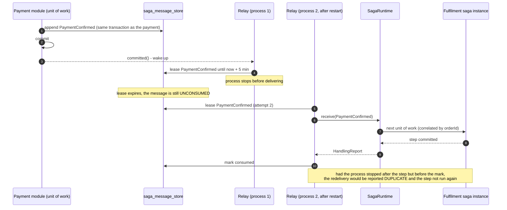
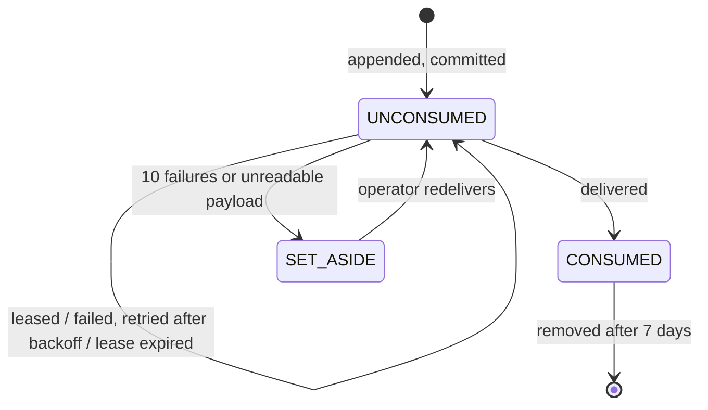

# Architecture

This document describes the target design of Saga Forge: what is built today, what is planned, and the
reasoning behind the boundaries between modules. See the root [README.md](../README.md) for the pitch and
[use-cases.md](use-cases.md) for worked examples.

## Status at a glance

| Layer | State |
|---|---|
| Annotation model (`@Saga`, `@SagaId`, `@SagaStep`, `@StartSaga`, `@EndSaga`, `@StartCompensation`, `@SagaCompensation`, `@DomainEvent`, `@Command`, `@Aggregate`, `@AggregateIdentifier`, `@CommandHandler`, `@AggregateLoader`, `@AggregateSaver`) | Implemented, tested |
| `AnnotationScanner` / `ReflectiveAnnotationScanner` / `SagaValidationResult` / `validateAll` → `ValidationReport` | Implemented, tested |
| `DomainEvents.record` / `DomainEventScope` (thread-bound event recording) | Implemented, tested |
| `SagaContext` / `SagaLifecycle` (`start`, `recordStepCompleted`, `advance`, `complete(sagaId, outcomeStep)`, `fail`) | Contracts defined; implemented by the runtime (`saga-forge-runtime`, [004](../specs/004-saga-engine/spec.md)), tested |
| `CommandGateway`, `EventPublisher` | Contracts defined; behavior specified by [contracts/saga-unit-of-work.md](../specs/002-transactional-step-sequence/contracts/saga-unit-of-work.md) and proven by a test-only harness; implemented by the runtime (004), tested |
| SPI `AggregateResolver`, `HandlerInstanceProvider`, `SagaContextStore` / `SagaContextRecord` | Contracts defined; behavior specified by [contracts/saga-unit-of-work.md](../specs/002-transactional-step-sequence/contracts/saga-unit-of-work.md) and proven by a test-only harness; implemented by the runtime (004), tested |
| `SagaInstance` step records (`StepRecord`: `NOT_RUN`/`COMPLETED` + touched aggregates), `outcome`, `failure` (`SagaFailure`) | Contracts defined; behavior specified by [contracts/saga-unit-of-work.md](../specs/002-transactional-step-sequence/contracts/saga-unit-of-work.md) and proven by a test-only harness; implemented by the runtime (004), tested |
| SPI (`StorageProvider`, `EventDispatcher`) | Defined; Postgres implements `StorageProvider` and `SagaContextStore` ([003](../specs/003-postgres-saga-persistence/spec.md)) and joins the runtime's transaction (004); the in-memory transport implements `EventDispatcher` (007) |
| SPI added by 004 (`EventReceiver`/`HandlingReport`, `TransactionBoundary`/`LocalTransaction`, `Outbox`/`OutgoingMessages` (named `EventHandoff`/`HandedOffEvents` until 007), `HandlerParameterResolver`, `SagaObjectProvider`, `SagaConcurrencyConflictException`, `StorageProvider.findByIdAndLock`) | Defined; used by the runtime, tested; `JdbcTransactionBoundary` in the Postgres module |
| `SagaLifecycleEntry` / `SagaLifecycleEventKind` (storage-agnostic lifecycle history) | Defined, tested; produced by the runtime, persisted by storage in hand-over order through `save(instance, entries)`; no query API |
| Saga runtime (`saga-forge-runtime`: event routing, saga-scoped unit of work, one unit of work per instance, outbox SPI, startup validation) | Implemented, unit-tested over in-memory doubles ([004](../specs/004-saga-engine/spec.md)); not yet run against Postgres |
| Step retry and idempotent command processing (`@SagaStep(retry = @RetryPolicy(...))`, `core.failure` markers and `FailureClassification`, `CommandId`, `HandlingOutcome.DUPLICATE`, `SagaInstance.pendingRetry`, `StepRecord.attempts`/`handledCommands`) | Implemented in core and the runtime, persisted by Postgres, tested, including the Postgres container suites ([005](../specs/005-step-retry/spec.md)) |
| Compensation (`@StartCompensation`, `@SagaCompensation` run by the runtime, `CompensationTrigger`, `SagaStatus.COMPENSATED`/`REQUIRES_INTERVENTION`, `StepRecord.completionSequence`/`compensation`) | Implemented in core and the runtime, persisted by Postgres, tested, including the Postgres container suites ([006](../specs/006-saga-compensation/spec.md)) |
| Storage providers (Postgres, MySQL, MongoDB) | Postgres implemented, tested; MySQL and MongoDB not implemented |
| Message store (`core.spi.store.MessageStore`), outbox commands (`@Command(delivery = OUTBOX)`, `CommandReceiver`, rule R23, Property 35), `Outbox.committed` | Implemented in core and the runtime, Postgres log (`PostgresMessageStore`), tested, including container suites ([007](../specs/007-in-memory-transport/spec.md)) |
| Transports (in-memory, Kafka) | In-memory implemented with a durable message store, tested ([007](../specs/007-in-memory-transport/spec.md)); Kafka not implemented |
| Spring Boot auto-configuration | Implemented, tested, including container suites ([008](../specs/008-spring-boot-starter/spec.md)): model collection, storage detection, runtime assembly and lifecycle, Spring host SPIs (saga beans, handler beans and parameters, Spring Data aggregates), failure analysis, overrides, `saga-forge.*` properties, Spring Modulith listener delivery, Actuator endpoint and health; the in-memory transport's wiring from [007](../specs/007-in-memory-transport/spec.md) |
| Saga test fixture (`saga-forge-test`: `SagaFixture` given/when/then, record-and-answer or handler mode, failure rules, `FixtureClock`, durable `SagaContext` value check) and the `CommandInterceptor` SPI (Property 36) | Implemented, tested, with a parity suite against a hand-assembled runtime ([009](../specs/009-saga-test-fixture/spec.md)) |

## Module responsibilities

- **`saga-forge-core`** — owns the annotation model, the scanner that validates and reflects over `@Saga`
  classes, the `SagaContext`/`SagaLifecycle`/`CommandGateway`/`EventPublisher` contracts (interfaces only,
  no implementation), `DomainEvents.record`, and the SPI contracts. Zero runtime dependencies, including no
  Spring dependency. This is deliberate: the annotation model and validation rules must be usable from a
  future non-Spring runtime without forcing a Spring dependency on every consumer.
- **`saga-forge-runtime`** — the saga runtime over the core SPI, depending on `saga-forge-core` and the JDK only.
  `SagaRuntime` is the `EventReceiver` transports deliver to: it routes each event to saga types and instances by
  association, runs each saga-scoped unit of work in the host's local transaction through `TransactionBoundary`,
  allows one unit of work per instance at a time, stores committed events in an `Outbox`, and validates the
  registered model and plug-ins at `start()`. Host integrations assemble it through its builder; application
  developers using the starter never do.
- **`saga-forge-test`** — the saga test fixture applications add in test scope (009), depending on
  `saga-forge-core` and `saga-forge-runtime` only. `SagaFixture` builds and starts the shipped `SagaRuntime` over
  in-memory plug-ins of its own: a transaction boundary, storage, a context store that rejects values durable storage
  cannot persist, an aggregate store, a synchronous loop-back transport, a controllable clock and deterministic ids.
  It sees every command through the core `CommandInterceptor` SPI, which lets it record commands whose handler a test
  did not register and make commands fail. It adds no execution semantics of its own; `FixtureParityTest` checks it
  against a hand-assembled runtime.
- **`saga-forge-spring-boot-starter`** — the only module users explicitly add for wiring (008; details in
  [its README](../saga-forge-spring-boot-starter/README.md)). It:
  - collects the saga model from the auto-configuration packages, the application's beans,
    `saga-forge.scan-packages` and `SagaModelContributor` beans;
  - detects the storage module and builds Postgres storage, context store and message store over the application's
    `DataSource`, with `SpringTransactionBoundary` joining the application's transactions;
  - backs the host SPIs with Spring: prototype saga beans (or the no-argument constructor), handler beans, handler
    parameters resolved like injection points, aggregates through their Spring Data repositories;
  - builds the `SagaRuntime` bean and starts it in a `SmartLifecycle` one phase before the transport, which stops
    first;
  - publishes every recorded domain event through Spring's `ApplicationEventPublisher` inside the unit of work
    (`saga-forge.application-events.mode`), so Spring Modulith's `@ApplicationModuleListener`s receive saga events
    with Modulith's guarantees, and with Modulith's registry present keeps the transport's messages there too (one
    outbox);
  - exposes a read-only `sagaforge` Actuator endpoint and health indicator.

  Every bean backs off for an application bean of its type. There is no `SagaRuntimeConfig` for a user to
  hand-build. Ambiguity (two storage modules, two runtimes) and every misconfiguration fail startup with a
  `FailureAnalyzer` description and action rather than a guess.
- **`saga-forge-storage-{postgres,mysql,mongodb}`** — each implements `StorageProvider` and
  `SagaContextStore` for one backend, and persists the lifecycle entries the runtime hands over
  (`SagaLifecycleEntry`: creation, step completions, terminal outcome), numbered in hand-over order, for direct
  data-store inspection only. Only Postgres exists so far.
  Exactly one should be on the classpath per application. These are the only three storage backends in
  scope; adding a fourth is a scope decision, not an implementation detail.
- **`saga-forge-transport-{inmemory,kafka}`** — each implements `EventDispatcher`. In-memory (007) is a
  transactional outbox plus an in-process relay: every outgoing event (and `@Command(delivery = OUTBOX)` command)
  is appended to a durable `MessageStore` in the unit of work's transaction (an `IN_TRANSACTION` `Outbox`) and
  delivered at least once, in per-aggregate order, from the same process; unconsumed messages survive a restart.
  It depends on `saga-forge-core` only — no Spring — so Spring and (later) Quarkus hosts only supply transactions,
  an executor and lifecycle. Kafka wraps a `KafkaTemplate`/consumer pair. These are the only two transports in
  scope. If neither is on the classpath, the starter falls back to in-memory as the default rather than failing,
  since in-memory requires no external infrastructure.
- **`saga-forge-example`** — a runnable saga (`OrderProcessingSaga`) used as a living spec. It must always
  compile against whatever the annotation model currently supports; if an annotation's contract changes, the
  example changes with it in the same change.
- **`saga-forge-example-spring`** — the same saga as a Spring Boot application (008): `Order` as a Spring Data JDBC
  aggregate, `PaymentService` as a bean, `OrderPlacement` publishing the start event in a `@Transactional` method,
  and no Saga Forge assembly code. Spring stays out of `saga-forge-example`, which keeps its framework-free role.

## Autoconfiguration detection matrix

Implemented by 008 for Postgres and the in-memory transport; the MySQL, MongoDB and Kafka rows are the target.

| Classpath signal | Storage provider selected |
|---|---|
| `saga-forge-storage-postgres` plus a `DataSource` and `PlatformTransactionManager` | `saga-forge-storage-postgres` (implemented) |
| `saga-forge-storage-postgres` without a `DataSource` | Startup fails naming the missing beans and `spring.datasource.*` |
| MySQL driver | `saga-forge-storage-mysql` (target) |
| MongoDB driver | `saga-forge-storage-mongodb` (target) |
| Several storage modules | Startup fails unless `saga-forge.storage.type` selects one |
| None of the above | Startup fails naming the module to add — a saga needs durable storage, so there is no silent fallback |

| Classpath signal | Transport selected |
|---|---|
| `org.apache.kafka.clients.producer.KafkaProducer` | `saga-forge-transport-kafka` (target) |
| Neither Kafka nor any other broker client present | `saga-forge-transport-inmemory` (default, implemented) |

Exactly one storage provider and one transport are expected to resolve. Autoconfiguration does not attempt to
support running two storage providers or two transports simultaneously.

## Why orchestration on an event-driven substrate

Steps are triggered by domain events. A step is a `void` method that dispatches zero or more commands through
the saga's `CommandGateway` field; each command runs its single `@CommandHandler` synchronously, and the
handler records the resulting domain events with `DomainEvents.record`. Work is grouped into a **saga-scoped
unit of work** (specified in
[contracts/saga-unit-of-work.md](../specs/002-transactional-step-sequence/contracts/saga-unit-of-work.md)):

- Inside a unit of work, delivery is in-process. An event recorded there that triggers another step of the
  same saga instance is queued and run in the same transaction, without passing through the transport.
- The unit of work commits at the first `@EndSaga` step or at a **wait point** (no queued step left). Only
  then are its buffered events handed to its `Outbox` — with the in-memory transport, rows of the message store
  written in that same transaction, delivered after commit; with Kafka, records.
- The transport carries events only *between* units of work: an external event (or one published through
  `EventPublisher` outside any unit of work) starts or resumes a saga instance in a new unit of work.

At the transport level this is choreography: no central dispatcher decides what happens next. But every
`@Saga` instance keeps durable process state — its `SagaInstance` record (status, per-step `StepRecord`s,
`outcome`, `failure`) through a `StorageProvider`, and its named business state through `SagaContext`,
persisted as a `SagaContextRecord` via `SagaContextStore`. The runtime (`saga-forge-runtime`) drives these, and
Postgres implements the storage and the context store. With
that state you can ask "where is this saga, and what has it already done" without replaying every event it
reacted to. That queryable, durable process state is what makes this orchestration rather than pure
choreography — it is layered on top of an event-driven delivery mechanism, not a replacement for one.

This process state is also the intended foundation for **downstream policies**: a policy that needs to know
"has the payment step for this booking already completed" should be able to answer that by reading saga
process state (through a `@ReadModel`-backed repository) rather than re-deriving it from raw event history.

## How saga instances exchange messages (in-memory transport)

Saga instances never call each other. They meet only through messages: a step sends commands, a handler records
domain events, and an event that another saga instance reacts to travels through the transport. With the in-memory
transport ([007](../specs/007-in-memory-transport/spec.md)) every such message is first written to a durable message
log in the same transaction as the saga state that produced it, and only then delivered — in the same process, by a
relay that survives restarts.

### The path of one message

```mermaid
flowchart LR
    subgraph UOW["Unit of work (one local transaction)"]
        direction TB
        STEP["Saga step<br/>@SagaStep"] -->|"commandGateway.send"| HANDLER["@CommandHandler<br/>(IN_UNIT_OF_WORK)"]
        HANDLER -->|"DomainEvents.record"| BUFFER["Recorded events and<br/>OUTBOX commands"]
        STEP -->|"send a OUTBOX command"| BUFFER
        BUFFER -->|"Outbox.store<br/>(IN_TRANSACTION)"| WRITE[("saga_instance<br/>saga_message_store")]
    end

    WRITE -->|"commit, then Outbox.committed<br/>wakes the relay"| RELAY

    subgraph TRANSPORT["InMemoryTransport (same process)"]
        direction TB
        RELAY["Relay: polling loop<br/>lease / renew / release"] -->|"one lane per<br/>ordering key"| WORKERS["Keyed workers"]
    end

    WORKERS -->|"event"| RECEIVER["SagaRuntime<br/>EventReceiver"]
    WORKERS -->|"OUTBOX command"| CRECEIVER["SagaRuntime<br/>CommandReceiver"]
    RECEIVER -->|"correlate by<br/>associationProperty"| NEXT["Next unit of work of<br/>the same or another saga"]
    CRECEIVER -->|"handler in its own unit of work;<br/>consumed mark in the same transaction"| NEXT
    WORKERS -.->|"fails 10 times or<br/>cannot be read"| ASIDE["SET_ASIDE<br/>(operator redelivers)"]
```

1. **Inside a unit of work** nothing leaves the process yet. An event that triggers another step of the *same*
   instance runs in the same transaction; every other event, and every command marked
   `@Command(delivery = OUTBOX)`, is buffered.
2. **At commit** the buffer becomes rows of `saga_message_store`, written by the `IN_TRANSACTION` `Outbox` in the same
   transaction as the saga instance. A rollback leaves no row behind, so a rolled-back unit of work is never seen by
   anyone.
3. **After commit** `Outbox.committed` wakes the relay; a 500 ms poll is the safety net.
4. **The relay leases** committed messages: it reserves them for itself for a limited time, at most one message per
   ordering key (an event's aggregate), and hands each to a worker lane for that key, so one aggregate's messages
   arrive in order while others run in parallel.
5. **Delivery**: an event goes to the runtime's `EventReceiver`, which finds the saga instances it concerns by their
   `associationProperty` and runs each one's next unit of work — whose own outgoing messages start at step 1 again.
   A outbox command goes to the runtime's `CommandReceiver`, which runs its handler in a unit of work of its own and
   marks the message consumed inside that transaction.
6. **Failures** are retried with growing backoff. After the tenth failure, or at once if the payload cannot be read,
   the message is set aside; it no longer blocks its aggregate and an operator can deliver it again.

### Surviving a restart

A clean shutdown releases its leases at once, so the next start does not wait for them to expire.

### Message states

### Patterns behind the design

The transport is assembled from well-known messaging patterns, so its behaviour should feel familiar. The
names on the left are from *Enterprise Integration Patterns* (Hohpe and Woolf) unless marked otherwise.

| Pattern | Where it shows up in Saga Forge |
|---|---|
| [Process Manager](https://www.enterpriseintegrationpatterns.com/patterns/messaging/ProcessManager.html) | A `@Saga` instance: durable process state (`SagaInstance`, `SagaContext`) that decides the next step from the messages it receives. The [Saga pattern](https://microservices.io/patterns/data/saga.html) (microservices.io) adds compensation. |
| [Correlation Identifier](https://www.enterpriseintegrationpatterns.com/patterns/messaging/CorrelationIdentifier.html) | `@SagaStep(associationProperty = "...")`: the runtime finds the saga instances an event belongs to by this value. |
| [Event Message](https://www.enterpriseintegrationpatterns.com/patterns/messaging/EventMessage.html) / [Command Message](https://www.enterpriseintegrationpatterns.com/patterns/messaging/CommandMessage.html) | `@DomainEvent` types (published, possibly many interested sagas) and `@Command` types (exactly one `@CommandHandler`). |
| [Transactional Outbox](https://microservices.io/patterns/data/transactional-outbox.html) (microservices.io), building on [Transactional Client](https://www.enterpriseintegrationpatterns.com/patterns/messaging/TransactionalClient.html) | The `IN_TRANSACTION` `Outbox`: outgoing messages are rows written in the unit of work's own transaction, so state and messages commit or roll back together. |
| [Guaranteed Delivery](https://www.enterpriseintegrationpatterns.com/patterns/messaging/GuaranteedMessaging.html), [Message Store](https://www.enterpriseintegrationpatterns.com/patterns/messaging/MessageStore.html) | `MessageStore` (`saga_message_store`): every message is stored before it is delivered, kept until consumed, then for 7 days for diagnostics. |
| Message Relay / [Polling Publisher](https://microservices.io/patterns/data/polling-publisher.html) (microservices.io), [Polling Consumer](https://www.enterpriseintegrationpatterns.com/patterns/messaging/PollingConsumer.html) | The `Relay`: a polling loop that reads committed rows from the log and delivers them; woken early by `Outbox.committed`. |
| Lease (Gray and Cheriton, 1989; also SQS's visibility timeout, Pub/Sub's ack deadline) | `MessageStore.lease` / `renew` / `release`: a reservation with an expiry, so a crashed process's messages become available again without cleanup. It is what would let [Competing Consumers](https://www.enterpriseintegrationpatterns.com/patterns/messaging/CompetingConsumers.html) share a log safely, although this transport targets one running instance. |
| [Message Dispatcher](https://www.enterpriseintegrationpatterns.com/patterns/messaging/MessageDispatcher.html), with ordering keys in the spirit of Kafka partition keys and JMS message groups | The keyed worker lanes: one lane per ordering key keeps an aggregate's messages in order while different aggregates are delivered in parallel. |
| [Idempotent Receiver](https://www.enterpriseintegrationpatterns.com/patterns/messaging/IdempotentReceiver.html) / [Idempotent Consumer](https://microservices.io/patterns/communication-style/idempotent-consumer.html) (microservices.io) | Delivery is at least once. The runtime reports a redelivered event of a completed step as `DUPLICATE`, and a handler passes `CommandId` on as the idempotency key; a outbox command is marked consumed in its handler's transaction. |
| [Dead Letter Channel](https://www.enterpriseintegrationpatterns.com/patterns/messaging/DeadLetterChannel.html), [Invalid Message Channel](https://www.enterpriseintegrationpatterns.com/patterns/messaging/InvalidMessageChannel.html) | `SET_ASIDE` with reason `MAX_ATTEMPTS` (delivery kept failing) or `UNREADABLE` (the payload cannot be decoded), visible through `MessageStoreQueries` and redeliverable by an operator. |

In a Spring application with Spring Modulith, the Message Store is Spring Modulith's event publication registry
instead, and Saga Forge keeps only its delivery records beside it: one outbox per application, not two
([007](../specs/007-in-memory-transport/spec.md) FR-028).

## Truthful state and transaction boundaries

A step is only ever recorded `COMPLETED` if its unit of work committed. The aggregate changes made by the
command handlers a unit of work dispatched, the step records, the saga's status and its outcome commit
together, in the host's local transaction — never as an independent "fire and forget" write afterward.
Buffered events are dispatched only after that commit.

If any step, handler, loader, saver, resolver or provider throws — including a failure a step caught — the
whole unit of work rolls back: its aggregate changes and buffered events are discarded, and the instance is
then written as `FAILED` with a `SagaFailure` in a separate write. `SagaContext` values are the deliberate
exception: they are saved through `SagaContextStore` outside the saga transaction, so they survive the
rollback.

This is inherited directly from production experience in `docs/use-cases.md`: a step recorded as completed
despite its business effect being rolled back is a worse failure mode than the step simply failing, because it
silently breaks the saga's ability to resume or retry correctly.

## Feature gaps

The following are requirements a production-grade saga runtime must satisfy, derived from real multi-step,
multi-aggregate orchestration use cases (see [use-cases.md](use-cases.md)). None of them has a runtime in
`saga-forge-core` today; some now have their contracts defined, as noted per item. They are listed here as the
backlog for the runtime/starter work, each phrased as a capability the framework must provide — not as an
implementation prescription.

### Queryable process-level state (highest priority)

Today a step can only see the fields carried on the single event instance it receives. There is no way for a
step to read a value that an *earlier* step in the same saga instance computed or loaded, unless that value
was manually threaded forward through a chain of growing event types — which does not scale past a handful of
steps and forces every event type to carry the full upstream state it never otherwise needs.

The framework must provide a **general, queryable process-state store per saga instance**. The contract
half of this is now **defined** in `saga-forge-core`; the runtime and persistence half is **still open**.

What is defined (contract only, in `core.lifecycle`):

- A `@Saga` class may declare at most one `SagaContext`-typed field (recognized by type, no annotation;
  enforced by the scanner). Through it, a step associates a named value with the current saga instance
  (`context.putState("apartment", apartment)`), and a later step reads it back by name and type
  (`context.getState("apartment", Apartment.class)`). Individual fields of a structured value can be
  updated in place with `context.updateStateAttribute(name, field, value)`.
- Reads are type-safe: a stored value not assignable to the requested type raises
  `SagaStateTypeMismatchException`, and a field update against a scalar value raises
  `NonStructuredStateValueException`. Null values are rejected on write, so an empty `Optional` from
  `getState` always means "never written".
- The representation is settled: named values live in a `SagaContextRecord` (`sagaId`, `values`,
  `lastModifiedAt`), stored through the `SagaContextStore` SPI as a record of its own, separate from the
  `SagaInstance` record. A structured value is a nested `Map<String, Object>`. `SagaInstance.state` holds
  only the saga class's own fields, not `SagaContext` values.
- Context writes happen outside the saga-scoped unit of work: `putState` / `updateStateAttribute` changes are
  saved no later than the end of the step that made them, and a `SagaContextStore.save` never joins the saga
  transaction. Values therefore survive a rollback, and a record may exist for a `FAILED` instance.
- These contracts are exercised only through test-only doubles and the test-only harness; no production
  `SagaContext` or `SagaLifecycle` implementation ships. `saga-forge-storage-postgres` ships the first
  production `SagaContextStore` (and `StorageProvider`).

What remains to be built (the runtime/persistence half):

- No engine exists to load a saga's `SagaContextRecord` and populate its `SagaContext` field when a unit of
  work begins, or to save what a step wrote.
- Because different units of work — possibly on a different thread, or a different process entirely if the
  transport is Kafka — cannot share Java object identity or a live `ThreadLocal`, this state must round-trip
  through a concrete `SagaContextStore` between units of work. The Postgres `SagaContextStore` and
  `StorageProvider` can hold that state, but no engine round-trips it yet, so cross-unit-of-work persistence
  of `SagaContext` state is still unbuilt.
- This is also the mechanism that should back the "process state available to downstream policies" principle
  already stated in the "Why orchestration on an event-driven substrate" section above — a `@ReadModel`-backed
  policy reading saga state should be reading through this same `SagaContext`-backed state, not a parallel
  mechanism.

### Idempotent step execution

**Implemented** by [005](../specs/005-step-retry/spec.md). An event for a step that already completed for the
instance is recognized after the unit of work's locked read and reported `DUPLICATE`: the step does not run, nothing
is written. This uses the instance's own step records, with no separate uniqueness table. Behind it, every command a
step sends carries a `CommandId` derived from the instance, the step, the command type and its position among
commands of that type in the step run. The identity is the same on every retry, redelivery and process. A handler
receives it as a parameter and passes it to outside systems as their idempotency key. The identities a step's
handlers handled commit with its `StepRecord`, and a command whose identity is already recorded is not handled again.

Still a gap: deduplicating the *triggering command* or request (two concurrent requests to accept the same booking)
before a saga instance exists, and a redelivered start event after a saga ended, which starts a new saga
(G-005-04).

### Per-step retry policy with failure classification

**Implemented** by [005](../specs/005-step-retry/spec.md), framework-owned (Constitution Principle II):

- A step declares `@SagaStep(retry = @RetryPolicy(maxAttempts, initialBackoffMillis, multiplier, maxBackoffMillis,
  retryOn))`. The scanner validates it (rule R19, Property 29 in `.kiro/specs/saga-forge-framework/design.md`), and
  engine startup rejects a policy whose total wait exceeds `SagaRuntime.Builder.maxTotalRetryBackoff` (default 30 s).
- Failures are classified with the core markers `TransientFailure` and `FinalFailure`, implemented by any exception
  class, and the policy's `retryOn` types. The result is `FailureClassification`: `TRANSIENT` (retried), `FINAL`,
  `EXHAUSTED` (transient, attempts used up) or `UNCLASSIFIED` (unmarked and not listed, for example a programming
  error; never retried).
- A retry re-runs the whole unit of work from its triggering event after an in-process, interruptible wait, holding
  the instance's in-process lock throughout. Before each wait the next attempt is claimed on
  `SagaInstance.pendingRetry` in its own write, so a restart never grants more attempts than the policy allows. A
  `FAILED` instance records the classification and attempt count on its `SagaFailure`.

Known limitations: no long or scheduled backoff (G-005-01); a waiting retry blocks the caller and holds the instance
(G-005-02); a retry of a start unit of work does not resume after a crash (G-005-06).

### Transaction boundary relative to the triggering dispatch

This is now **specified** by
[contracts/saga-unit-of-work.md](../specs/002-transactional-step-sequence/contracts/saga-unit-of-work.md): an
event arriving through the transport opens a new saga-scoped unit of work in the host's local transaction;
steps triggered in-process run inside it; it commits at the first `@EndSaga` step or at a wait point, and
rolls back as a whole on any failure. A later unit of work sees only what earlier units of work committed
(plus `SagaContext` values, which are written outside the transaction). At most one unit of work runs per
saga instance at a time.

This is now **implemented** by the runtime ([004](../specs/004-saga-engine/spec.md)): the runtime opens, commits and
rolls back the host's local transaction through `TransactionBoundary`/`LocalTransaction`; storage joins it through
`LocalTransaction.resource(Class)` (Postgres: the bound `java.sql.Connection`); a failed unit of work is recorded
`FAILED` in a separate write after the rollback; and one unit of work per instance is enforced in-process by a
per-instance lock and across processes by `StorageProvider.findByIdAndLock` (a pessimistic lock at the start of the
unit of work, no version field). Known limitations: a crash between the creation write and the first unit of work
strands a `CREATED` instance (G-ENG-05); the default `ImmediateDispatchOutbox` is at most once (G-ENG-07; the
in-memory transport's outbox closes it, 007); duplicate
starts are detected across processes only after the other creation write committed (G-ENG-08); the `FAILED` write
can mark an instance another process moved on (G-ENG-10); whether `begin()` suspends or rejects a host
transaction already active on the thread depends on the `TransactionBoundary` (G-ENG-12).

### Failure categorization and automatic compensation dispatch

This is now **implemented** ([006](../specs/006-saga-compensation/spec.md), building on the classification of
[005](../specs/005-step-retry/spec.md)). Everything inside one saga-scoped unit of work is already atomic, so
compensation undoes only steps whose units of work **already committed**:

- **Triggers.** A business failure is declared: the step that handles the failure event carries
  `@StartCompensation` next to `@SagaStep`, and its commit moves the instance to `COMPENSATING`. A technical failure
  starts compensation only when 005 classifies it `FINAL` (marked `FinalFailure`) or `EXHAUSTED` (retries used up)
  and at least one step had committed. An `UNCLASSIFIED` failure, or a final one with nothing committed, still ends
  the saga `FAILED`. The instance records the `CompensationTrigger` once: kind, step, event type or failure, time.
- **What runs, in which order.** Every `COMPLETED` step except the triggering `@StartCompensation` step, most
  recently completed first, by `StepRecord.completionSequence`. A step without a `@SagaCompensation` is
  `NOTHING_TO_COMPENSATE`; a step whose unit of work rolled back is never compensated.
- **How it runs.** Each compensation runs in its own saga-scoped unit of work, in the handling call that triggered
  compensation and under the instance lock: it may dispatch commands (with 005 identities scoped to the compensation
  method) and read and write `SagaContext`, and it may take the `CompensationTrigger` as its parameter. Its effects
  and its `COMPENSATED` mark commit together, and the last commit also ends the saga `COMPENSATED`. No forward step
  runs while compensating.
- **Requires intervention.** A compensation that fails is never retried: the unwinding stops, the step is recorded
  `FAILED` with the classified failure, steps not reached stay `NOT_ATTEMPTED`, and the saga ends
  `REQUIRES_INTERVENTION`. The stored instance alone shows the trigger and every committed step's compensation status
  and time.
- **Resume.** After a crash, the next event routed to a `COMPENSATING` instance (the redelivered trigger, or any
  forward event, whose step does not run) resumes with the first compensation not yet committed.

Known limitations: an instance left `COMPENSATING` with no further event never resumes (G-006-05); a compensation
sees the trigger's event type, not the event (G-006-06); compensations run on the caller's thread holding the
instance (G-006-08); a failed compensation is never retried and there is no operator path out of "requires
intervention" (G-006-09, G-006-03); a compensation does not wait for confirmation of the undo (G-006-02).

## jMolecules consideration

[jMolecules](https://github.com/xmolecules/jmolecules) provides DDD/architecture marker annotations
(`@AggregateRoot`, `@Entity`, `@Service`, etc.) and structural tests that verify a codebase actually respects
them. Saga Forge's own markers (`@DomainEvent`, `@Command`, `@ReadModel`) already play a similar role, but
narrower — they mark types for the scanner, not for architectural verification.

The intended integration, not yet decided or built, is **optional interop, not a hard dependency**:

- `saga-forge-core` should keep its own `@DomainEvent`/`@Command`/`@ReadModel` annotations as the primary
  contract the scanner validates against, since the framework cannot require every consumer to adopt
  jMolecules.
- A thin, separately-versioned adapter could recognize jMolecules' `@Event`, `@Service`-style annotations as
  equivalent, so teams already using jMolecules don't have to double-annotate their types. This is additive
  and should not change `saga-forge-core`'s zero-dependency posture.
- Until this is designed in detail, treat jMolecules support as unimplemented and don't assume any
  recognition of jMolecules annotations exists.

## Vocabulary

Saga Forge borrows its vocabulary from DDD / EventStorming rather than inventing new terms.

- **Command** — an instruction expressing intent to change state, handled by exactly one `@CommandHandler`.
  Dispatched through the command gateway; a step never returns one. A command aimed at an existing aggregate
  carries that aggregate's identity in its `@AggregateIdentifier` field. Marked with `@Command`.
- **Command gateway** — the `CommandGateway` contract that runs a command's single handler synchronously,
  inside the caller's unit of work. A saga reaches it through one optional `CommandGateway`-typed field
  (recognized by type, no annotation); services and application code get it by dependency injection.
- **Command handler** — a `@CommandHandler` method or constructor taking one `@Command` parameter. On an
  `@Aggregate`, an instance method runs on the aggregate loaded by the command's `@AggregateIdentifier` (via a
  client `@AggregateLoader`, else the host's `AggregateResolver`), which is then saved (via `@AggregateSaver`,
  else the resolver, else the client's own unit of work); a constructor or static factory creates a new
  aggregate. On a service, the instance comes from the host's `HandlerInstanceProvider`. Never declared on a
  `@Saga`.
- **Event** (Domain Event) — a fact about one aggregate that already happened. Declares its aggregate with
  `@DomainEvent(aggregate = X.class)` and carries exactly one `@AggregateIdentifier` field. Recorded with the
  static `DomainEvents.record(...)` (no base class or interface), or published with an injectable
  `EventPublisher` outside a unit of work. Client code is responsible for recording an event only after a real
  state transition; Saga Forge does not check this. Saga steps react to events; they never react to commands.
- **Aggregate** — the consistency boundary that owns the state a command changes and the events that record
  that change. Marked with `@Aggregate`, identified by an `@AggregateIdentifier` field. Its persistence is
  owned by client code; Saga Forge never reaches inside an aggregate, it only dispatches commands to its
  handlers and listens for its events.
- **Policy** — the cross-aggregate rule a saga encodes: "when X happens, Y should happen." A `@Saga` class is
  a declarative expression of one or more related policies, scoped by a shared association property.
- **Projection** (Read Model) — a denormalized view built from events, used to enrich a step's decision
  without reaching into another aggregate's internals. Accessed via a repository injected into the saga;
  types exposed this way are marked `@ReadModel`.
- **Saga** — the durable, single-process orchestrator for one instance of a policy, identified by `@SagaId`
  and correlated to events via `associationProperty`. Not to be confused with the Saga pattern in the generic
  distributed-transaction sense — here it specifically means an annotated class matching this framework's
  model.
- **Step** — one unit of saga behavior: a `void` method triggered by one event type, correlated via
  `associationProperty`, that dispatches zero or more commands through the command gateway and may start
  (`@StartSaga`) or end (`@EndSaga`) the saga's lifecycle. Declared with `@SagaStep`.
- **Saga-scoped unit of work** — the transaction in which a triggered step and every step it triggers
  in-process run. It commits at the first `@EndSaga` step or at a wait point; any failure rolls it back and
  leaves the saga `FAILED`. Specified in
  [contracts/saga-unit-of-work.md](../specs/002-transactional-step-sequence/contracts/saga-unit-of-work.md).
- **Outcome** — the `@EndSaga` step a completed saga reached, recorded as `SagaInstance.outcome`. A saga may
  declare several `@EndSaga` steps, one per possible outcome.
- **Compensation** — the declared undo for a step whose business effect must be reversed after a later step
  fails. Declared with `@SagaCompensation(forStep = "...")`, scoped to exactly one step by name, and run by the
  engine in its own unit of work when the saga compensates (see "Failure categorization and automatic compensation
  dispatch").
- **Failure outcome** — a `@StartCompensation` step: the step that handles a business-failure event and, by
  committing, starts compensation. Its name is recorded in the instance's `CompensationTrigger`, the way an
  `@EndSaga` step's name is recorded as the outcome.
